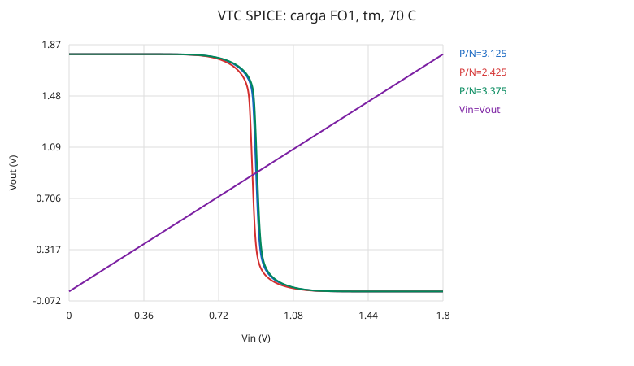
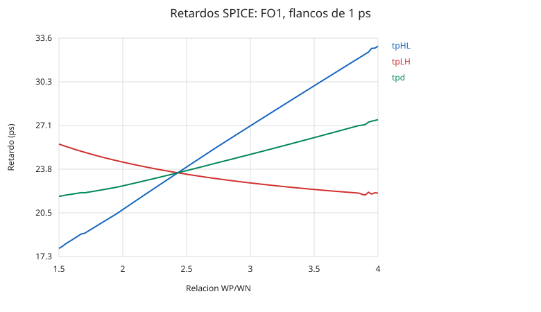
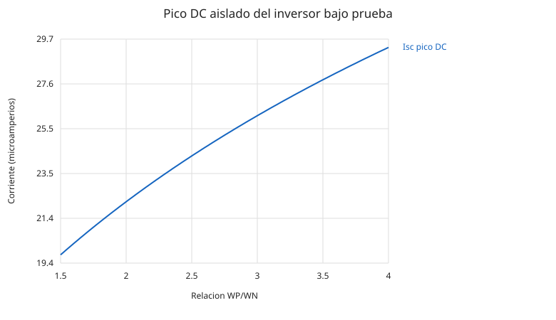
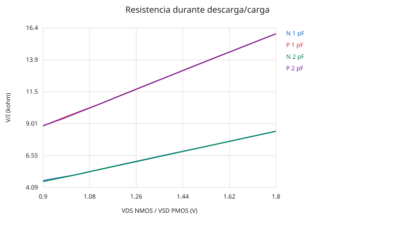
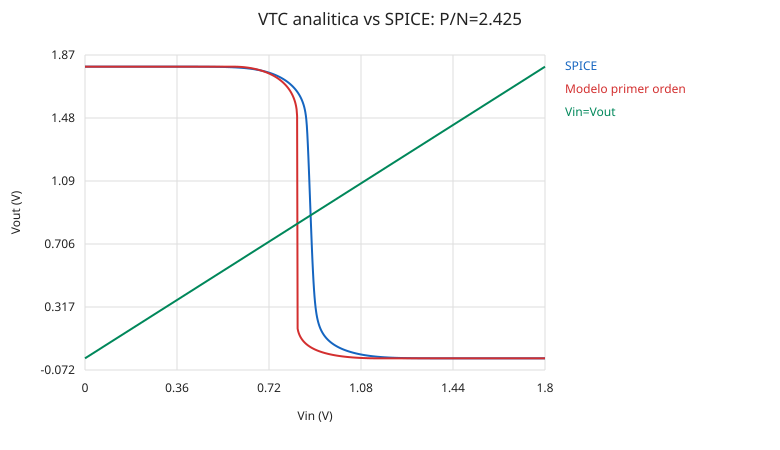
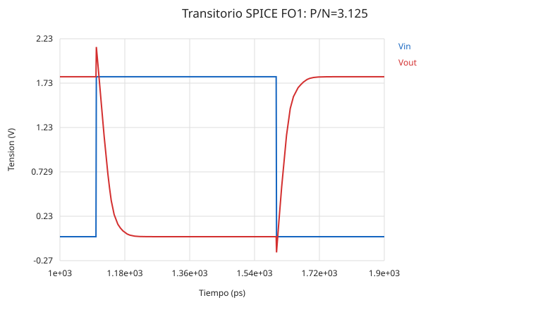
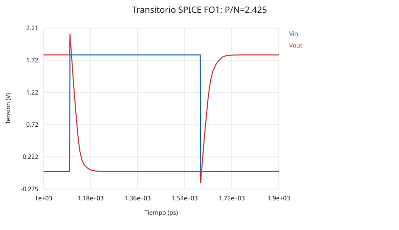

# Antecedentes y memoria de cálculo extendida
Tarea_1_Introducción al diseño de circuitos integrados

> **Estado del informe:** la sección [Resultados de la nueva caracterización](#resultados-de-la-nueva-caracterización) y las secciones analíticas que le siguen constituyen el análisis vigente. Las secciones anteriores conservan antecedentes y aproximaciones iniciales; no son resultados finales. Ya se incluyen VTC analítica y SPICE, ondas temporales, extracción de resistencias e iteración. El modelo analítico muestra discrepancias que se cuantifican, no se ocultan.

### Lectura del informe

- [Resultados medidos e iteración](#resultados-de-la-nueva-caracterización).
- [Modelo analítico por regiones y contraste DC](#modelo-analítico-por-regiones-y-contraste-dc).
- [Análisis dinámico independiente y restricción de simetría](#análisis-dinámico-independiente-y-restricción-de-simetría).
- [Respuesta temporal verificada](#respuesta-temporal-verificada).
- [Validaciones pendientes](#validaciones-pendientes).

## Caracterización preliminar del proceso XT018 (insumo para la Parte 2)

### Curvas I-V de transistores mínimos
#### Fórmula de la resistencia cuando el transistor esta saturado
$$R_{eff} = \frac{3In(2)}{4} \frac{V_{DD}}{I_{sat}}  \quad(1)$$ 

#### Fórmula de la resistencia cuando el transistor esta en transición
$$R_{eff} = \frac{V_{DD}}{I_{H}+I_{L}}  \quad(2)$$
\
\
Los valores para los siguientes cáculos se tomaron de los parámetros para transistores 1.8V (ne,pe) de un proceso XT018 - 0.18 µm. Además para los cáculos realizados, se desprecia $I_{L}$, ya que su valor en comparación con otras corrientes en el circuitos es muy pequeña. Para calcular la resistencia del transistor completo se escaló la corriente por unidad de ancho usando el ancho del transistor.

### Cáculos para transistor NMOS
A continuación se presentan los cálculo con la ecuación (1).
$$R_{eff} = \frac{3In(2)}{4} \frac{1.8V}{475 \times 10^{-6} A/{\micro m} \cdot 0.36{\micro m}} \approx 5.5 k\ohm $$  

Ahora con la ecuación (2).
$$R_{eff} = \frac{1.8V} {(475 \times 10^{-6} A/{\micro m}) \cdot 0.36{\micro m}} \approx 10.6 k\ohm$$
\
Para determinar la resistencia unitaria de un transistor NMOS para el proceso XT018 - 0.18 µm se realiza de la siguiente forma.
$$R_{nueff} = \frac{1.8V} {(475 \times 10^{-6} A/{\micro m})} \approx 3.8 k\ohm * {\micro m}$$

Estos valores difieren ya que la ecuación que usa la corriente de saturación solo funcionaría para transistores digitalizados que operen siempre en saturación de velocidad.
### Análisis empírico
Para determinar de forma empírica el valor de resistencia del transistor NMOS para el proceso XT018 se montó el deck `nmos_test.sp` y luego se exportaron en un archivo .csv para gráficarlas en python y se obtuvieron las siguientes gráficas.


Para determinar la resistencia mediante la ecuación (1) se utilizó la gráfica de la función de transferencia de NMOS, con esta se aproximo el valor de $I_{sat}$ y se realizó el cálculo que se presenta a continuación. 

$$R_{eff} =\frac{3In(2)}{4} \frac{1.8V} {213.7 \micro A} \approx 4.4 k\ohm$$

Con ayuda de la gráfica de la curva característica del transistor NMOS se extrajeron los datos de $I_H$ e $I_L$, estos dieron como resultado $199 \micro A$ y $29.07 \micro A$ respectivamente, una vez obtenidos los datos se procedió a resolver la ecuación (2), el resultado se presenta a continuación. 

$$R_{eff} =  \frac{1.8V}{199 \micro A  + 29.07 \micro A}  \approx 7.9 k\ohm $$  

Con los valores obtenido anteriormente se determinó la resistencia unitaria para un transistor NMOS, el cual se obtuvo el siguiente resultado. 
$$R_{nueff} = 7.9 k\ohm \cdot 0.36 \micro m \approx 2.84 k\ohm\cdot\micro m$$


### Cáculos para transistor PMOS
A continuación se presentan los cálculo con la ecuación (1).
$$R_{eff} = \frac{3In(2)}{4} \frac{1.8V}{170 \times 10^{-6} A/{\micro m} \cdot 0.72{\micro m}} \approx 7.7 k\ohm $$ 

Ahora con la ecuación (2).
$$R_{eff} = \frac{1.8V} {(170 \times 10^{-6} A/{\micro m}) \cdot 0.72{\micro m}} \approx 14.7 k\ohm$$
\
El deck de prueba usa el valor por defecto `P=8` y una escala de 90 nm, por lo que el ancho PMOS es 0.72 µm. Para determinar la resistencia unitaria de ese transistor:
$$R_{pueff} = \frac{1.8V} {(170 \times 10^{-6} A/{\micro m})} \approx 10.6 k\ohm * {\micro m}$$

### Análisis empírico
Una manera muy parecida se realizó para determinarlo los valores de resistencia de PMOS pero en este caso se uso el deck `pmos_test.sp`, para posteriomente realizar el mismo procedimiento que el nmos, a continuación se presenta las gráficas y los cálculos realizados. 


Primero se presenta los cálculos con la ecuación (1).
$$R_{eff} =\frac{3In(2)}{4} \frac{1.8V} {180.5 \micro A} \approx 5.2 k\ohm$$

Ahora con la ecuación (2) donde con ayuda de la gráfica se determinó que $I_H=102\micro A$ e $I_L=13.01\micro A$.

$$R_{eff} =  \frac{1.8V}{102 \micro A + 13.01 \micro A}  \approx 15.65 k\ohm $$  

Para determinar la resistencia unitaria de un transistor PMOS para el proceso XT018 - 0.18 µm se realiza de la siguiente forma.
$$R_{pueff} = 15.65 k\ohm \cdot 0.72 \micro m \approx 11.27 k\ohm\cdot\micro m$$

Se normaliza como \(R W\), no como \(R/W\), porque la resistencia de primer orden disminuye al aumentar el ancho. Estos valores históricos no sustituyen la extracción por descarga presentada al final.
\
\
Al comparar los datos obtenidos con los valores teóricos, se aprecian diferencias de alrededor de $4 k\ohm$ máximo. Esto se debe a que el analísis teórico realizado se cálculo con valor de $W/L= (10/0.18) \micro m/\micro m$, ya que el parámetros porporcionados para la tecnología XT018 mostraban ese valor, lo cual implica un gran impacto en los valores debido a que no se considera el valor mínimo de ancho necesario para esta tecngología que es $0.36 \micro m$. Por lo que, al tenes este parámetro diferente al requerido, se puede considerar que los valores teóricos generados tiene una pequeña discrepancia con respecto a los datos experimentales.  

En estos datos históricos el PMOS de 0.72 micrometros tiene aproximadamente el doble de resistencia que el NMOS de 0.36 micrometros. No es una comparación a igual ancho; los nuevos resultados sí emplean ambos transistores de 0.36 micrometros.

> Las curvas I-V de esta sección son caracterización complementaria. La prueba requerida por 2.a y su promedio en el intervalo \(V_{DD}\) a \(V_{DD}/2\) se documentan en "Resultados de la nueva caracterización".

### Estimación preliminar de capacitancia de compuerta y constante RC (insumo para Parte 2.b)
Los valores para los siguientes cáculos se tomaron de los parámetros para transistores 1.8V (ne,pe) de un proceso XT018 - 0.18 µm.

#### Fórmula de la capacitancia parásita si se considera pesimista 
$$C_{gs} = W_{dib} L_{dib}C_{ox} +  W_{dib}  C_{ov}  \quad(3)$$

#### Fórmula de la constante RC ($\tau$) 
$$\tau = 3R_{n}C  \quad(4)$$

$$\tau = (3/2) R_{p}C  \quad(5)$$

### Transistor NMOS
#### Cálculo de la capacitancia 
A continuación se presentan los cálculo con la ecuación (3).
$$C_{gn} = 0.36\micro m \cdot 0.18\micro m \cdot 8.46 fF/\micro{m}^{2} +  0.36\micro m \cdot 0.33 fF/\micro m $$
$$C_{gn} \approx 0.67 fF$$

#### Cálculo de la constante RC ($\tau$)
Para determinar la constante RC para el transistor NMOS se utlizó la ecuación (4), el desarollo de la misma se presenta a continuación.
$$\tau = 3 \cdot 10.6 k\ohm \cdot 0.67 fF = 21.31 ps$$


### Transistor PMOS
#### Cálculo de la capacitancia 
A continuación se presentan los cálculo con la ecuación (3).
$$C_{gp} = 0.72\micro m \cdot 0.18\micro m \cdot 8.91 fF/\micro{m}^{2} +  0.72\micro m \cdot 0.32 fF/\micro m $$
$$C_{gp} \approx 1.39 fF$$

#### Cálculo de la constante RC ($\tau$)
Para determinar la constante RC para el transistor PMOS se utlizó la ecuación (5), el desarollo de la misma se presenta a continuación.
$$\tau = 3/2 \cdot 14.7 k\ohm \cdot 1.39fF = 30.64 ps$$

> Los valores anteriores son estimaciones preliminares de capacitancia de compuerta. La extracción e iteración nuevas aparecen al final; usan difusión aproximada según [4], no parámetros de unión extraídos directamente del modelo BSIM.


## Parte 1. Diseño y caracterización del inversor CMOS mínimo
### Parte 1.a. Dimensionamiento y VTC del inversor

#### Inversor de tamaño mínimo 

Se diseñó a nivel de esquemático el inversor que se muestra en la siguiente figura:


Este cuenta con un NMOS de tamaño mínimo permitido por las reglas escalables con contactos en las difusiones para la tecnología utilizada. Teniendo un valor de lambda de 90 nm, la expresión del transistor mínimo 4/2 lambda resulta en un ancho de NMOS de 360 nm.

Se busca centrar el punto de conmutación imponiendo \(V_{in}=V_{out}=V_{DD}/2\). Esto no garantiza por sí solo márgenes de ruido iguales ni requiere necesariamente \(\beta_p/\beta_n=1\): también influyen los umbrales y el modelo de corriente. Se diseñó el deck de HSPICE `inverter_transfer.sp` para obtener las funciones de transferencia de diferentes relaciones de anchos P/N:


#### Dimensionamiento analítico de primer orden

Se fija \(V_{DD}=1.8\,\mathrm{V}\), \(V_M=V_{DD}/2=0.9\,\mathrm{V}\), \(W_N=0.36\,\mu\mathrm{m}\) y \(L=0.18\,\mu\mathrm{m}\). Para el punto \(V_{in}=V_{out}=V_M\), las magnitudes de las tensiones de sobreexcitación son:

$$V_{OV,n}=V_M-V_{TN}=0.9-0.58=0.32\,\mathrm{V}$$
$$V_{OV,p}=V_{DD}-V_M-|V_{TP}|=0.9-0.65=0.25\,\mathrm{V}$$

Los valores de umbral se toman de la fila de canal mínimo \(W/L=10/0.18\) del documento de parámetros de primer orden [4]. Para ambos transistores, \(V_{DS}=V_{SD}=0.9\,\mathrm{V}\), mayor que sus respectivos sobrevoltajes. Esto satisface la condición de saturación del modelo de canal largo en el punto de conmutación, aunque no prueba por sí solo que el transistor esté en saturación de velocidad.

Como el canal dibujado es mínimo (\(L=0.18\,\mu\mathrm{m}\)), no se adopta el modelo cuadrático de canal largo como predicción principal: el documento [4] advierte que es probable la saturación de velocidad, al menos en NMOS, y que \(K'_L\) está medido en la región lineal para transistores largos. Se usa, por tanto, una aproximación de corriente limitada por velocidad, lineal con el sobrevoltaje:

$$\frac{I_D}{W}\approx \frac{I_{ON}}{V_{DD}-V_T}V_{OV}$$

Esta extrapolación usa \(I_{ON}\) por unidad de ancho medido a \(V_{GS}=V_{DS}=1.8\,\mathrm{V}\); no es un modelo BSIM ni una medida a \(V_M\). Con \(I_{ON,n}=475\,\mu\mathrm{A}/\mu\mathrm{m}\) e \(I_{ON,p}=170\,\mu\mathrm{A}/\mu\mathrm{m}\):

$$\left.\frac{I_n}{W_n}\right|_{V_M}\approx475\frac{0.32}{1.8-0.58}=124.6\,\mu\mathrm{A}/\mu\mathrm{m}$$
$$\left.\frac{|I_p|}{W_p}\right|_{V_M}\approx170\frac{0.25}{1.8-0.65}=37.0\,\mu\mathrm{A}/\mu\mathrm{m}$$

Imponiendo \(I_n=|I_p|\) en \(V_M\), se obtiene:

$$\frac{W_p}{W_n}\approx\frac{(I_n/W_n)}{(|I_p|/W_p)}=\frac{124.6}{37.0}=3.37$$
$$W_p\approx3.37(0.36\,\mu\mathrm{m})=1.21\,\mu\mathrm{m}\approx13.5\lambda$$

Como contraste, el modelo cuadrático de canal largo daría \(W_p/W_n=(K'_n/K'_p)(V_{OV,n}/V_{OV,p})^2=(256/52)(0.32/0.25)^2\approx8.07\), o \(W_p\approx2.91\,\mu\mathrm{m}\). Se reporta solo como comparación: \(K'_L\) corresponde a la región lineal y los valores son de canal largo, por lo que su uso con \(L=0.18\,\mu\mathrm{m}\) no representa bien el régimen probable del NMOS mínimo.

La barrida histórica sugería una relación aproximada de 3.1:1. La nueva barrida de paso 0.025 encuentra 3.125:1 como el punto muestreado más cercano a \(V_M=0.9\) V, frente a la predicción de primer orden 3.37:1. La diferencia de tamaño es aproximadamente 7.9% respecto al valor simulado. La extrapolación de \(I_{ON}\), los umbrales de otra geometría y los efectos de canal corto limitan la precisión; las capacitancias no explican el desplazamiento de una VTC en equilibrio DC. Además, debe comprobarse la correspondencia XH018 de [4] con XT018 de las librerías.

La corriente de cortocircuito existe cuando ambos transistores conducen; su máximo debe buscarse en el barrido, no suponerse en \(V_{out}=V_{DD}/2\). La siguiente figura historica no se considera una medición válida de corriente:


El archivo histórico reporta 0.8973 para P/N=3:1, pero la instrucción `.measure DC Isc when V(out)=0.9v` no solicita ninguna corriente: devuelve la coordenada del barrido de entrada donde se cumple la condición. El nombre `Isc` no transforma esa tensión en corriente. Se descarta su interpretación previa como amperios o miliamperios y se sustituirá la gráfica usando la corriente de alimentación aislada del inversor bajo prueba.

> La aproximación lineal anterior solo estima un punto DC y no define una VTC por regiones. Su coincidencia aproximada con el ratio SPICE no demuestra que ambos dispositivos estén saturados en velocidad. La VTC completa y las limitaciones de los modelos se presentan en "Modelo analítico por regiones y contraste DC".

Los análisis anteriores se realizaron para una esquina de variabilidad del proceso "tm typical medium", que representa el comportamiento neutral. No obstante, se pueden realizar análisis en otras esquinas de variabilidad donde se sesga el inversor, haciendo más rápido el PMOS o el NMOS. Se llevó a cabo este análisis en las siguientes esquinas:

- WP: worst case power; NMOS rápido y PMOS rápido
- WS: worst case speed; NMOS lento y PMOS lento
- WO: worst case one; NMOS rápido y PMOS lento
- WZ: worst case zero; NMOS lento y PMOS rápido

Se simuló el inversor para cada esquina de variabilidad para obtener los tiempos de transición:


De estos datos, se obtuvieron los respectivos tiempos de propagación de subida y de caída para cada esquina:


### Análisis complementario: cadena FO4 y optimización de retardos

#### FO4

Se montó el FO4 que propone el libro [1], este se encuentra en `fo4_ratios.sp`. Con una ratio P/N de 2:1 se obtuvieron las señales en cada etapa del FO4:

Se obtuvo un tpdr = 80.76 ps, un tpdf = 70.34 ps y un tpd = 75.55 ps.


Este análisis de una cadena FO4 es complementario; por sí solo no reemplaza el caso de la consigna 1.b, que considera un inversor manejando una carga similar a sí mismo.

#### Estimación analítica con carga de un inversor idéntico

Se interpreta “carga similar a sí mismo” como un inversor idéntico conectado a la salida. Se conserva \(W_N=0.36\,\mu\mathrm{m}\) y se dimensiona \(W_P\) para que los retardos de subida y bajada sean iguales. En el modelo RC de primer orden:

$$t_{pHL}\approx0.69R_nC_L,\qquad t_{pLH}\approx0.69R_pC_L$$

Si se aproxima la carga por una misma capacitancia constante para ambos flancos, la condición de simetría es \(R_{n,eff}=R_{p,eff}\). Estas resistencias describen la transición con entrada cerca de los rieles; no son las resistencias en el equilibrio DC con entrada de 0.9 V. Por tanto, el ratio 3.37 de 1.a no se puede presentar como solución dinámica sin otra extracción.

Como punto de partida independiente para el barrido, igualar corrientes de encendido por ancho a entrada completamente activada da \(W_P/W_N\approx475/170=2.79\). Es solo una estimación inicial: las corrientes cambian durante la transición y la razón definitiva debe obtenerse de las resistencias efectivas y verificarse por simetría de retardos.

Para estimar la carga se usa el modelo pesimista de capacitancias de [4], \(C_g=W_{dib}L_{dib}C_{ox}+W_{dib}C_{ov}\), y la aproximación del mismo documento \(C_{db}=C_{sb}=C_g\). Sin capacitancia de cableado:

$$C_{g,n}=0.36(0.18)(8.46)+0.36(0.33)=0.667\,\mathrm{fF}$$
$$C_{g,p}=1.21(0.18)(8.91)+1.21(0.32)\approx2.33\,\mathrm{fF}$$
$$C_L\approx C_{g,n}+C_{g,p}+C_{db,n}+C_{db,p}\approx2(C_{g,n}+C_{g,p})=6.00\,\mathrm{fF}$$

Las capacitancias anteriores corresponden al tamaño DC de 1.a. Se recalcularán para cada tamaño del PMOS durante la iteración de 2.b. Para un ratio \(r=W_P/W_N\), el modelo aproximado del documento da:

$$C_L(r)\approx2[0.667008+0.36r(0.18\cdot8.91+0.32)]\,\mathrm{fF}$$

**Corrección metodológica:** se retira la predicción anterior de 83 ps, obtenida usando corriente de equilibrio DC como corriente del flanco. Esa sustitución no representa las condiciones de entrada de la prueba temporal. El análisis dinámico independiente al final integra corrientes con puerta completamente activada; no se ajusta artificialmente para coincidir con SPICE.

#### Primera comprobación con el tamaño DC

Los archivos de `spice_decks/resultados_revision_20261116_213433` reportan, para el tamaño \(W_P=1.215\,\mu\mathrm{m}\), esquina `tm` y 70 grados Celsius:

| Medida | Resultado |
|---|---:|
| Entrada para salida de 0.9 V (no cruce exacto Vin=Vout) | 0.9058 V |
| Retardo alto a bajo | 30.11 ps |
| Retardo bajo a alto | 23.47 ps |
| Retardo promedio | 26.79 ps |

La diferencia de retardos es aproximadamente 6.64 ps, o 24.8% del promedio: este tamaño no garantiza simetría dinámica. La entrada de esta primera prueba tiene flancos de 10 ps; el nuevo barrido usa flancos de 1 ps y mide el segundo ciclo, por lo que no se deben exigir números idénticos entre ambas pruebas.

La medida DC de aproximadamente -49.77 microamperios corresponde a la alimentación conjunta de dos etapas. No se reporta como corriente exclusiva del inversor bajo prueba.

Para facilitar esa comprobación se prepararon dos decks: `spice_decks/self_loaded_inverter_dc.sp` barre la entrada para obtener la VTC, el umbral medido y la corriente de alimentación en \(V_{out}=V_{DD}/2\); `spice_decks/self_loaded_inverter_tran.sp` mide \(tpHL\), \(tpLH\), \(tpd\), \(tfall\) y \(trise\) con entrada cuadrada. Ambos instancian dos inversores idénticos con \(N=4\), \(P=13.5\) y `scale=90n`, que corresponden a \(W_N=0.36\,\mu\mathrm{m}\) y \(W_P=1.215\,\mu\mathrm{m}\). Ejecutar desde `spice_decks` para que se resuelva el `.include 'min_inverter.sp'`. Las librerías se referencian desde `/mnt/vol_NFS_rh003/estudiantes/dmedina_cadence/vlsi/Hspice/lp5mos/` y deben estar disponibles en el entorno HSPICE.

#### Optimización manual
Para lograr tener la mínima diferencia entre los tiempos de propagación de subida y de bajada se modificó el deck para probar distintos ratios P/N automáticamente, este se encuentra en `fo4_ratios.sp`. Se obtuvieron las siguietes gráficas:

Para los tiempos de propagación para los distintos ratios P/N:


De este barrido de parámetros, se concluye que el ratio P/N óptimo es de 3.4 : 1, obteniendo una diferencia de 0.21 ps. En contraste, una relación 2:1 tiene una diferencia de 10.43 ps en los tiempos de propagación. A pesar de que la relación 2:1 no es simétrica, en promedio es más rápida que la relación en el punto optimizado. La relación 2:1 tiene un tiempo de propagación promedio de 75.55 ps mientras que la relación 3.4 : 1 tiene un tiempo de propagación promedio de 87.17 ps.

Para la potencia promedio para los distintos ratios P/N:


Analizando la potencia promedio, esta es directamente proporcional al ratio P/N. Para una relación 2:1 se tiene una potencia promedio de 4.94 mW meintras que para la relación en el punto de optimización se tienen 6.99 mW.

#### Optimización de hspice

Se realizó una optimización automática en hspice con el deck `fo4_opt.sp`. Se obtuvieron los siguientes datos:

|  P/λ    | bestratio | tpdr     | tpdf     | tpd      | diff     | Temperatura|
|---------|-----------|----------|----------|----------|----------|------------|
| 13.2009 | 3.3002    | 86.52 ps | 85.11 ps | 85.81 ps | 1.41 ps  | 70.00 C    |

El optimizador resultó en que el mejor ratio es de 3.3:1, con un ancho del PMOS de 13.2009 * 90nm. La diferencia entre \(tpdr\) y \(tpdf\), calculada a partir de los datos de la tabla, es de 1.41 ps.

Tanto el proceso de optimización manual como el generado por hspice convergen a resultados aproximados. El realizado manualmente llega a un punto de mayor simetría en tiempos de propagación pero el PMOS llega a ser más rápido que el NMOS, en constraste, la optimización automática encontró el mejor punto de simetría pero donde el NMOS seguía siendo más rápido que el PMOS. En términos de potencia ambas optimizaciones disipan más que un ratio 2:1 y la relación 2:1 es más rápida al tener un tpd menor que ambas optimizaciones. Por último, en términos de área se puede ver que se llegan a anchos de hasta 13.2 veces λ lo que implica un gran área para la implementación física.

Tomando todos estos parámetros en consideración, se puede concluir que valores cercanos a ratios de 2:1 y 3:1 pueden cumplir para distintos requisitos de diseño, ya sea en consumo de potencia, velocidad o simetría de las señales.

> La selección por simetría, el recálculo de capacitancias, la comparación DC y las gráficas temporales se documentan al final. El resultado temporal se declara como óptimo de la malla, sin afirmar más precisión que la disponible.

### Parte 2.b (continuación). Resultados preliminares de extracción de resistencia desde retardos

Los siguientes valores históricos se conservan como antecedentes, no como extracción final: no tienen una memoria de cálculo verificable. Se sustituyen para la comparación por los resultados nuevos al final.

En base a la siguiente ecuación se realizarán los cálculos de resistencia efectiva:
$tpdr = \frac{3}{2} * R_{p} * C$

|  Transistor    | Parametro | Valor (kΩ)     | 
|----------------|-----------|----------------|
| NMOS           | Rn        | 14.92          | 
| PMOS           | Rp        | 27.82          | 

### Parte 2.c. Comparación de métodos

La comparación cuantitativa entre descarga y extracción desde retardos, a igual ancho de referencia, se presenta al final.

## Nueva ronda de simulaciones para completar el informe

Ejecutar en Linux, desde la raíz del proyecto:

```bash
bash spice_decks/run_characterization.sh
```

El script conserva cada ejecución en una carpeta nueva dentro de `spice_decks` y comprueba errores, medidas fallidas y fin normal de HSPICE. No ejecuta los decks históricos.

| Deck | Objetivo |
|---|---|
| `characterization_dc.sp` | VTC, cruce exacto Vin=Vout y pico de corriente DC del inversor bajo prueba, con alimentación separada de la carga. |
| `characterization_tran.sp` | Barrido FO1 de P/N entre 1.5 y 4 con paso 0.025; incluye 2, 3.1 y 3.375. Mide retardos, diferencia y asimetría porcentual en segundo ciclo. |
| `channel_discharge.sp` | Pruebas duales NMOS y PMOS mínimos de 0.36/0.18 micrometros con capacitores de 1 y 2 pF. |

Los nuevos decks usan `characterization_common.inc`, que conserva las geometrías de difusión de la celda original pero expone las alimentaciones y usa el nodo de referencia 0. Todos usan esquina `tm` y temperatura de 70 grados Celsius. No se suman capacitores analíticos a la carga FO1: el modelo SPICE ya contiene capacitancias.

En la prueba de descarga, el capacitor NMOS comienza a 1.8 V y descarga; el capacitor PMOS comienza en 0 V y carga, de modo que su \(V_{SD}\) cae de 1.8 a 0.9 V. Se exportan tensiones y corrientes con `.print` y `.probe` para calcular:

$$R_n(t)=\frac{V(dn)}{I(VSN)},\qquad R_p(t)=\frac{V_{DD}-V(dp)}{-I(VSP)}$$

El promedio se calcula solo en el intervalo donde cada tensión de canal está entre \(V_{DD}\) y \(V_{DD}/2\), documentando el muestreo. Las medidas `rn_rc` y `rp_rc`, obtenidas como \(t_{1/2}/(\ln(2)C)\), son referencias RC adicionales y no sustituyen ese promedio.

Conservar la carpeta de resultados completa, especialmente los `.lis`, `.ms0.csv`, `.mt0.csv` y las formas de onda. Las salidas impresas de los `.lis` permiten analizar las descargas sin depender de un lector de archivos binarios. Los tres decks fueron ejecutados en el servidor sin errores ni advertencias en los listados de esta ronda.

## Resultados de la nueva caracterización

Fuente: [ejecución resultados_caracterizacion_20261116_231335_H9qsFY](spice_decks/resultados_caracterizacion_20261116_231335_H9qsFY), HSPICE U-2023.03-SP2, alimentación de 1.8 V, esquina `tm`, temperatura 70 grados Celsius. Se verificaron 101 ratios en DC y 101 en transitorio, sin medidas fallidas. El análisis se reproduce desde la raíz con Python, sin paquetes externos:

```bash
python scripts_py/analyze_characterization.py spice_decks/resultados_caracterizacion_20261116_231335_H9qsFY
```

El script genera [comparación de todos los ratios](spice_decks/resultados_caracterizacion_20261116_231335_H9qsFY/analisis/comparacion.csv), [resistencias por descarga](spice_decks/resultados_caracterizacion_20261116_231335_H9qsFY/analisis/resistencias.csv) e [iteración de tamaños](spice_decks/resultados_caracterizacion_20261116_231335_H9qsFY/analisis/iteracion.csv).

### 1.a y 1.b: dos objetivos de dimensionamiento distintos

Las siguientes medidas provienen de la misma malla de ratios y condiciones. El transitorio usa entrada con flancos de 1 ps y segundo ciclo; no se compara directamente con el primer deck de flancos de 10 ps como si fueran condiciones idénticas.

| Diseño | P/N | WP (micrometros) | VM (V) | Pico DC aislado (microamperios) | tpHL (ps) | tpLH (ps) | tpd (ps) | Asimetría (%) |
|---|---:|---:|---:|---:|---:|---:|---:|---:|
| Inicial de la iteración | 2.000 | 0.720 | 0.870233 | 22.1810 | 20.7808 | 24.3265 | 22.5537 | 15.721 |
| Mejor simetría temporal muestreada (1.b) | 2.425 | 0.873 | 0.882846 | 23.9902 | 23.4876 | 23.5374 | 23.5125 | 0.212 |
| Mejor centrado DC muestreado (1.a) | 3.125 | 1.125 | 0.900232 | 26.5702 | 27.7825 | 22.6371 | 25.2098 | 20.410 |
| Aproximación analítica DC redondeada | 3.375 | 1.215 | 0.905662 | 27.3961 | 29.2768 | 22.3946 | 25.8357 | 26.638 |

Se define asimetría como \(100|t_{pLH}-t_{pHL}|/t_{pd}\). En 1.a, el error de VM es solo 0.232 mV respecto a 0.9 V. En 1.b, la diferencia temporal es 0.04982 ps en la malla disponible. Esto no demuestra un óptimo continuo: requiere un barrido más fino alrededor de 2.425. Tampoco se minimiza el retardo sin restricciones: P/N=2 tiene menor promedio pero no iguala los flancos.

El cambio del diseño centrado DC al de simetría temporal reduce el retardo promedio aproximadamente 6.7% y el pico DC aproximadamente 9.7%, a costa de desplazar VM a 0.88285 V. La igualdad de corrientes en el cruce DC no impone igualdad de retardos con entrada activada completamente. Los tiempos 20-80% para P/N=2.425 son \(tfall=24.1922\) ps y \(trise=29.2776\) ps: retardos de propagación iguales no significan tiempos de transición iguales.







Las medidas de pico son \(\max[-I(VDRV)]\) durante la barrida DC. Incluyen la pequeña fuga de la etapa bajo prueba, no la corriente de la carga. No equivalen al máximo de corriente de alimentación durante un transitorio, que también contiene carga/descarga capacitiva. Sustituyen la antigua gráfica inválida etiquetada como Isc.

### 2.a: resistencia promedio por descarga de capacitor

Ambos dispositivos tienen W/L=0.36/0.18 micrometros. Se promedia aritméticamente \(V_{DS}/I\) para NMOS y \(V_{SD}/|I|\) para PMOS, usando puntos impresos uniformemente cada 10 ps. Se excluye t=0 porque la inicialización UIC imprime corriente de fuente igual a cero. Solo se incluyen muestras con tensión de canal entre 0.9 y 1.8 V; no se extrapolan los extremos.

| Capacitor | Muestras NMOS | Rn promedio (kOhm) | Muestras PMOS | Rp promedio (kOhm) | Rn por tiempo medio (kOhm) | Rp por tiempo medio (kOhm) |
|---|---:|---:|---:|---:|---:|---:|
| 1 pF | 439 | 6.45319 | 833 | 12.33541 | 6.34709 | 12.02375 |
| 2 pF | 870 | 6.44970 | 1663 | 12.32330 | 6.27740 | 11.99938 |

Duplicar C cambia el promedio de V/I solo 0.054% para NMOS y 0.098% para PMOS. Esto respalda la estabilidad de la extracción frente al capacitor y que domina la carga externa; no separa por sí solo todos los errores de integración e inicialización. Se adopta la corrida de 2 pF como referencia: \(R_n=6.44970\) kOhm, \(R_p=12.32330\) kOhm, relación 1.91068 a igual ancho.

El promedio es uniforme en tiempo, no en voltaje. La resistencia por tiempo medio \(t_{1/2}/[\ln(2)C]\) tiene otra ponderación y no coincide necesariamente con la media de V/I para corriente no lineal. La corriente de fuente contiene también contribuciones de carga interna; el capacitor externo grande reduce su importancia relativa.



### 2.b: extracción desde retardo e iteración de capacitancias

Se usa el modelo aproximado de [4], no capacitancias de unión extraídas del BSIM:

$$C_{gn}=0.667008\ \mathrm{fF},\qquad C_{gp}(r)=0.692568r\ \mathrm{fF}$$
$$C_{db,n}\approx C_{gn},\quad C_{db,p}\approx C_{gp},\quad C_L(r)=2[C_{gn}+C_{gp}(r)]$$
$$R_{n,ret}=\frac{t_{pHL}}{\ln(2)C_L},\qquad R_{p,ret}(W_P)=\frac{t_{pLH}}{\ln(2)C_L}$$

Para comparar PMOS al mismo ancho de referencia de 0.36 micrometros, se adopta el escalamiento inverso con ancho \(R_{p,ret}(0.36)\approx rR_{p,ret}(W_P)\). Esta es una aproximación, pues el modelo real incluye efectos de ancho. Desde r=2 se recalcula la carga y se propone \(r_{nuevo}=R_{p,ret}(0.36)/R_{n,ret}\), eligiendo luego el punto de la malla más próximo:

| Paso | r usado | CL (fF) | Rn por retardo (kOhm) | Rp referido a 0.36 micrometros (kOhm) | r propuesto | Siguiente r de la malla |
|---|---:|---:|---:|---:|---:|---:|
| 0 | 2.000 | 4.104288 | 7.30465 | 17.10199 | 2.34125 | 2.350 |
| 1 | 2.350 | 4.589086 | 7.23544 | 17.47951 | 2.41582 | 2.425 |
| 2 | 2.425 | 4.692971 | 7.22047 | 17.54679 | 2.43014 | 2.425 |

La iteración converge en la malla disponible y coincide con el menor desequilibrio temporal observado. La extracción usa tiempos SPICE y CL calculada manualmente; no es una predicción independiente del retardo. Además, con carga común el cociente de resistencias cancela CL: la convergencia del ratio no valida la exactitud absoluta de las capacitancias.

### Predicción RC independiente y comparación de métodos (2.c)

Si se usan las resistencias de descarga a 2 pF y se supone \(R_p(W_P)=R_p(0.36)/r\), el modelo RC predice simetría en r=1.91068 y retardo aproximado de 17.80 ps. Esa predicción no coincide con el ratio temporal SPICE de 2.425: una resistencia extraída con capacitor grande y puerta fija no reproduce exactamente el inversor FO1.

Para comparar bajo el mismo tamaño r=2.425 y CL=4.69297 fF:

| Método | Rn (kOhm) | Rp referido a 0.36 micrometros (kOhm) | tpHL (ps) | tpLH (ps) |
|---|---:|---:|---:|---:|
| Descarga 2 pF + predicción RC | 6.44970 | 12.32330 | 20.98 | 16.53 |
| Extracción desde tiempos FO1 con CL aproximada | 7.22047 | 17.54679 | 23.49 medido | 23.54 medido |

Las resistencias extraídas por retardo exceden las de descarga aproximadamente 12.0% en NMOS y 42.4% en PMOS. La diferencia puede incluir dependencia no lineal de corriente y capacitancia, acoplamiento puerta-drenador, forma de onda de entrada, distinta trayectoria de polarización y errores de CL o del escalamiento con ancho. No se asigna toda la diferencia a un único efecto sin otra prueba.

Para representar retardo manual de compuertas similares se prefiere la calibración por retardo, porque refleja mejor ese entorno de operación, pero sus valores absolutos dependen de la precisión de CL. La descarga es más directa para verificar V/I con carga dominante y supone menos sobre la capacitancia interna; requiere simulaciones más largas (50 ns frente a 3 ns en estos decks). No se midió tiempo de CPU comparable, por lo que duración simulada no implica por sí sola mayor costo computacional.

### Modelo analítico por regiones y contraste DC

Se implementa en [first_order_model.py](scripts_py/first_order_model.py) un modelo gradual de primer orden con limitación de velocidad, en lugar de extrapolar una sola ecuación de saturación a toda la VTC. No se afirma que sea una reproducción exacta de BSIM ni de todos los modelos del libro. Usa longitudes dibujadas coherentes con los K' tabulados; no mezcla estos con longitudes efectivas sin recalibrar.

Para cada polaridad se usan magnitudes, \(u=\max(V_G-|V_T|,0)\), \(a=E_cL>0\), \(g=K'_L/L\), y:

$$V_{D,sat}=a\left(\sqrt{1+\frac{2u}{a}}-1\right),\quad d=\min(V_D,V_{D,sat})$$
$$j(V_G,V_D)=\frac{I}{W}=
g\frac{ud-d^2/2}{1+d/a}$$

En corte u=0 la corriente es cero. En región lineal se usa \(d=V_D\); en saturación se limita d al valor que hace cero la derivada de corriente respecto a VD. El modelo reduce al cuadrático para a muy grande y tiende a limitar la velocidad para campos altos. No incluye fuga, efecto de cuerpo, DIBL, modulación de longitud ni movilidad dependiente de campo vertical.

Al no disponer de Ec tabulado, se determina a usando exclusivamente el ION por ancho del PDF a VG=VD=1.8 V, no mediante ajuste a las VTC SPICE:

$$d_{ON}=\sqrt{\frac{2j_{ON}}{g}},\qquad
a=\frac{d_{ON}^2}{2(V_{DD}-|V_T|-d_{ON})}$$

| Polaridad | K'L (microamperios/V2) | Magnitud VT (V) | ION/W (microamperios/micrometro) | a inferido (V) |
|---|---:|---:|---:|---:|
| NMOS | 256 | 0.58 | 475 | 0.82935 |
| PMOS | 52 | 0.65 | 170 | 9.03392 |

Estos a son parámetros equivalentes de la aproximación, no campos críticos medidos ni prueba del régimen real. En particular, el PMOS queda casi cuadrático en este ajuste, contradiciendo el supuesto inicial de que ambas corrientes son lineales con sobrevoltaje cerca de VM. Para cada Vin se resuelve por bisección:

$$W_Nj_n(V_{in},V_{out})=
W_Pj_p(V_{DD}-V_{in},V_{DD}-V_{out})$$

La ausencia de modulación de longitud produce una transición abrupta en el modelo ideal; el algoritmo no agrega una pendiente empírica para disimularla. Se comparan las VTC en los mismos 901 puntos Vin de la simulación (0 a 1.8 V cada 2 mV). El error RMSE incluye el desplazamiento de la transición, no solo el error de VM:

| P/N | VM analítico (V) | VM SPICE (V) | Analítico menos SPICE (mV) | RMSE de Vout (V) |
|---|---:|---:|---:|---:|
| 3.125 | 0.849256 | 0.900232 | -50.976 | 0.23805 |
| 2.425 | 0.830066 | 0.882846 | -52.779 | 0.23982 |
| 3.375 | 0.855113 | 0.905662 | -50.549 | 0.23673 |




Para VM=0.9 V, este modelo por regiones predice \(r=j_n(0.9,0.9)/j_p(0.9,0.9)=6.10085\), WP=2.19631 micrometros. No se debe sustituir el ratio SPICE de 3.125 por esa predicción sin validarla: el modelo no representa adecuadamente estos dispositivos con los parámetros disponibles. La estimación lineal previa de 3.37 y esta predicción son hipótesis diferentes, no dos derivaciones equivalentes.

La discrepancia muestra que conocer ION a alimentación completa no determina por sí solo las corrientes cerca del umbral. K'L procede de canal largo, los umbrales de W=10 micrometros y VD=0.1 V, las simulaciones son a 70 grados Celsius y falta comprobar XH018/XT018. No se dispone de dependencias de temperatura, anchura y DIBL para corregirlas. También se omiten mecanismos de transporte de BSIM. Las capacitancias no justifican un error estático de VM. Para seleccionar tamaño se conserva el resultado SPICE; la predicción analítica y su error permanecen explícitos.

### Análisis dinámico independiente y restricción de simetría

Como cálculo separado del ajuste por tiempos, se usa el modelo por regiones con puerta totalmente activada para cada transistor y tensión de canal que recorre 1.8 a 0.9 V. De \(C\,dV/dt=-I(V)\):

$$t_{1/2}=C_L\int_{V_{DD}/2}^{V_{DD}}\frac{dV}{I(V)},\qquad
R_{eff,modelo}=\frac{1}{\ln 2}
\int_{V_{DD}/2}^{V_{DD}}\frac{dV}{I(V)}$$

La integral se evalúa por Simpson con 1000 subintervalos. Esta definición ponderada por descarga no es la media temporal de V/I solicitada en 2.a. Para W=0.36 micrometros da \(R_{n0}=7.59313\) kOhm y \(R_{p0}=21.25490\) kOhm, sin usar ningún retardo SPICE para calibrarlas.

Con \(r=W_P/W_N\), \(R_p=R_{p0}/r\) y \(C_L=A+Br\), donde A=1.334016 fF y B=1.385136 fF:

$$t_{HL}(r)=\ln 2\,R_{n0}(A+Br),\quad
t_{LH}(r)=\ln 2\,\frac{R_{p0}}r(A+Br)$$
$$t_{pd}(r)=\frac{\ln2}{2}(A+Br)
\left(R_{n0}+\frac{R_{p0}}r\right)$$

Sin restricción, derivar tpd da \(r_{min}=\sqrt{AR_{p0}/(BR_{n0})}\). Bajo la restricción solicitada de igualdad de retardos, en cambio, se exige \(r_{sym}=R_{p0}/R_{n0}=2.79923\). Para WN fijo la igualdad deja un único r en este modelo, no una optimización libre adicional. Si se permite tolerancia de asimetría, es necesario declararla y minimizar solo entre los tamaños que la cumplen.

| P/N | tpHL modelo (ps) | tpLH modelo (ps) | tpHL SPICE (ps) | tpLH SPICE (ps) |
|---|---:|---:|---:|---:|
| 2.425 | 24.6998 | 28.5115 | 23.4876 | 23.5374 |
| 3.125 | 29.8030 | 26.6961 | 27.7825 | 22.6371 |
| 2.79923 (simetría analítica) | 27.4280 | 27.4280 | No simulado exactamente | No simulado exactamente |

El barrido incluye r=2.8, para el cual SPICE obtiene 25.8240 y 23.0078 ps: no cumple simetría. Frente a la predicción 2.79923, el ajuste SPICE a r=2.425 reduce el ratio aproximadamente 13.4%. Las aproximaciones de capacitancia y escalamiento con ancho, el transporte no lineal y la entrada de tiempo finito explican posibles diferencias; esta comparación no identifica individualmente sus contribuciones.

### Respuesta temporal verificada

Se extrajeron directamente las ondas binarias `.tr0`, sin volver a ejecutar HSPICE ni reconstruirlas como exponenciales. El lector está restringido al formato 2013 little-endian y a las columnas verificadas de esta ejecución; rechaza otros encabezados. Se comprobaron los cruces de 0.9 V del segundo ciclo para los 101 ratios contra las medidas `.mt0.csv`. La máxima diferencia por interpolación fue inferior a 0.000002 ps. Se conserva la [verificación de todos los ratios](spice_decks/resultados_caracterizacion_20261116_231335_H9qsFY/analisis/verificacion_ondas.csv).





Las pequeñas sobreoscilaciones se muestran sin recortar los valores. Son tensiones simuladas del modelo y no se interpretan como evidencia de inductancia física ausente del deck. El análisis de tiempos usa los cruces, no el máximo de la señal.

### Validaciones pendientes

- **Tecnología:** verificar parámetros de difusión directamente en el modelo si se exige extracción literal del simulador. Se ha calculado CL usando la aproximación del material [4], no parámetros BSIM inventados.
- **Modelo analítico:** comprobar correspondencia XH018/XT018, umbrales y datos a la temperatura/geometría de prueba. La comparación VTC está terminada, pero evidencia que no es válido afirmar un dimensionamiento analítico exacto con estos parámetros.
- **Precisión opcional:** refinar alrededor de r=2.425 solo si se desea afirmar un óptimo con resolución mejor que 0.025; el informe actual declara explícitamente la malla.
- **Entrega:** los antecedentes anteriores conservan valores históricos descartados para trazabilidad. Para una versión final compacta, evaluar las secciones de resultados y análisis vigentes y trasladar antecedentes al material de apoyo, sin presentar ambas versiones como resultados simultáneamente válidos.

# Bibliografía
[1] N. Weste and D. Harris, CMOS VLSI Design: A Circuits and Systems Perspective, 4 edition.
Boston: Addison-Wesley, 2010.
[2] J. Rabaey, A. Chandrakasan y B. Nikolic. Digital Integrated Circuits: A Design Perspective.
[3] Process and Device Specification XH018 - 0.18 μm Modular Mixed Signal HV CMOS, PDS-018-
13. Release 7.0.1. XFAB Semiconductor Foundries, Nov. 2017.
[4] A. Chacón Rodríguez, *Parámetros de primer orden para tecnología XFAB 0.18 μm (Bulk CMOS XH018)*, material de curso, Instituto Tecnológico de Costa Rica, 2018.
