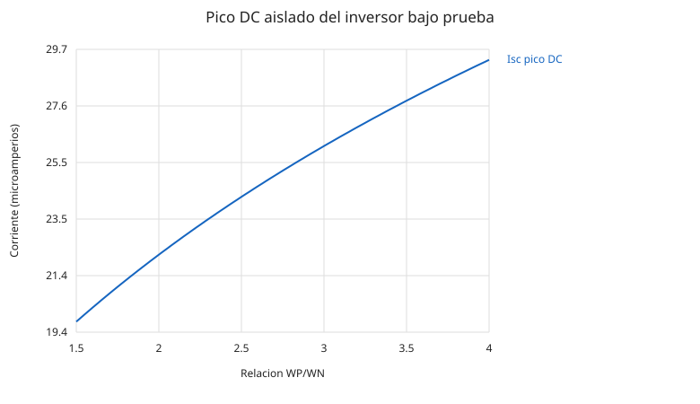
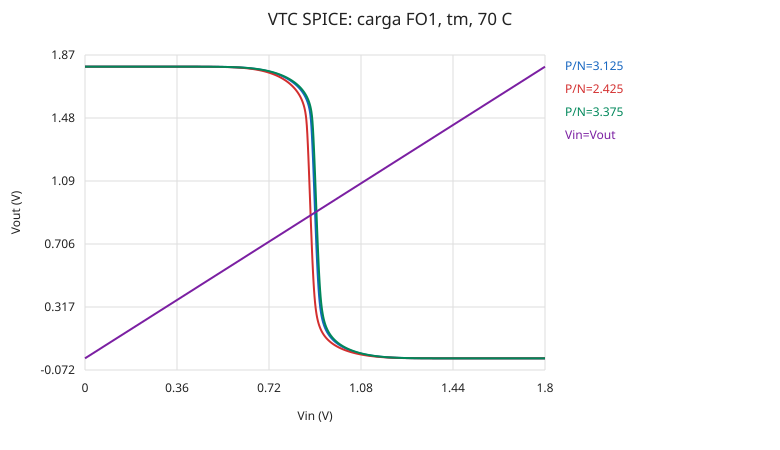
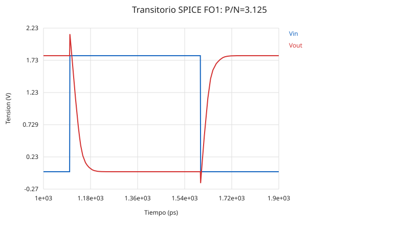
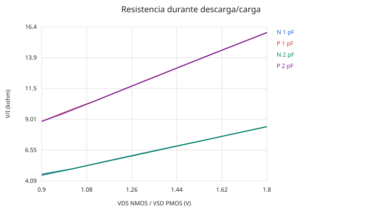

# Caracterización y dimensionamiento de un inversor CMOS

## Alcance y condiciones

Proyecto de caracterización de una tecnología de 0.18 micrometros, con alimentación de 1.8 V. Se estudian por separado el centrado de la VTC y la simetría de retardos. Se extrae resistencia efectiva por descarga de capacitor y por retardos de un inversor con carga idéntica (FO1).

Condiciones de las mediciones: HSPICE U-2023.03-SP2, esquina `tm`, temperatura 70 grados Celsius, modelos `ne` y `pe` de las librerías XT018 del servidor. Se dispone de parámetros analíticos XH018 [3]; su correspondencia exacta con esos modelos aún debe verificarse.

El NMOS de referencia usa W=4 lambda=0.36 micrometros y L=2 lambda=0.18 micrometros, con lambda=90 nm. Las difusiones se modelan con áreas W por 5 lambda y perímetros 2W+10 lambda, siguiendo la celda original con contactos. Estas dimensiones se usan como regla escalable de partida, no como una validación DRC nueva.

Los resultados vigentes están en este documento. El [README original](README.md) no se modifica; las estimaciones iniciales, correcciones y derivaciones ampliadas se conservan en [antecedentes y memoria extendida](README_antecedentes.md), sin considerarse simultáneamente resultados finales.

## 1.a. Dimensionamiento analítico y caracterización DC

### Parámetros y modelo por regiones

Se toman de [3] los siguientes parámetros. VT corresponde a W/L=10/0.18 micrometros y VD=0.1 V; K'L a transistores largos. No son valores extraídos a los anchos y temperatura de las pruebas.

| Parámetro | NMOS | PMOS |
|---|---:|---:|
| K'L (microamperios/V2) | 256 | 52 |
| Magnitud VT (V) | 0.58 | 0.65 |
| ION/W a VG=VD=1.8 V (microamperios/micrometro) | 475 | 170 |
| Cox (fF/micrometro2) | 8.46 | 8.91 |
| Cov (fF/micrometro) | 0.33 | 0.32 |

En el objetivo VM=0.9 V, los sobrevoltajes son 0.32 V y 0.25 V. Ambos transistores cumplen VD mayor que el sobrevoltaje en el criterio de saturación de canal largo; eso no demuestra saturación de velocidad. [3] advierte que puede haber saturación de velocidad, especialmente en NMOS mínimo.

Se implementa un modelo gradual con limitación de velocidad en [first_order_model.py](scripts_py/first_order_model.py). Para magnitudes de tensión, \(u=\max(V_G-|V_T|,0)\), \(a=E_cL>0\), \(g=K'_L/L\):

$$V_{D,sat}=a\left(\sqrt{1+\frac{2u}{a}}-1\right),\quad d=\min(V_D,V_{D,sat})$$
$$j(V_G,V_D)=\frac{I}{W}=g\frac{ud-d^2/2}{1+d/a}$$

En corte la corriente es cero. En región lineal d=VD y en saturación se limita d al punto donde la derivada de corriente se anula. Para a grande se recupera el modelo cuadrático; para campos altos se limita la corriente. Se omiten subumbral, DIBL, modulación de longitud, efecto de cuerpo y variaciones de movilidad con campo vertical.

Como no se dispone de Ec medido, a se infiere del ION tabulado, sin ajustar a la VTC SPICE:

$$d_{ON}=\sqrt{2j_{ON}/g},\qquad
a=\frac{d_{ON}^2}{2(V_{DD}-|V_T|-d_{ON})}$$

Resulta \(a_n=0.82935\) V y \(a_p=9.03392\) V. Son parámetros equivalentes, no mediciones del campo crítico. El PMOS queda cercano al régimen cuadrático; no es justificable asumir que ambos transistores son lineales con sobrevoltaje a partir solo de su longitud mínima.

La VTC se obtiene imponiendo:

$$W_Nj_n(V_{in},V_{out})=
W_Pj_p(V_{DD}-V_{in},V_{DD}-V_{out})$$

Para VM=0.9 V se predice P/N=6.10085, WP=2.19631 micrometros. La predicción no coincide con SPICE y no se usa como tamaño final. La estimación inicial lineal daba 3.37, pero era otra hipótesis y no una VTC por regiones validada. Se documenta el desacuerdo en lugar de escoger únicamente la aproximación más cercana.

### Contraste con SPICE y corriente DC aislada

Fuente: [resultados de la nueva ejecución](spice_decks/resultados_caracterizacion_20261116_231335_H9qsFY). Se midieron 101 ratios entre 1.5 y 4 con paso 0.025, y 901 puntos de entrada de 0 a 1.8 V cada 2 mV. No hubo errores, advertencias ni medidas fallidas en esta ronda.

El mejor centrado muestreado ocurre en P/N=3.125, WP=1.125 micrometros, VM=0.900232 V. El error respecto a VDD/2 es 0.232 mV. VM se mide en el cruce Vin=Vout, no solo donde Vout=0.9 V.

| P/N | VM analítico (V) | VM SPICE (V) | Error analítico menos SPICE (mV) | RMSE Vout en toda la VTC (V) |
|---|---:|---:|---:|---:|
| 3.125 | 0.849256 | 0.900232 | -50.976 | 0.23805 |
| 2.425 | 0.830066 | 0.882846 | -52.779 | 0.23982 |
| 3.375 | 0.855113 | 0.905662 | -50.549 | 0.23673 |


El modelo analítico sin modulación de longitud tiene una transición abrupta; no se añade una pendiente empírica para disimularlo. El RMSE incluye el desplazamiento de esa transición. La discrepancia puede originarse en parámetros de canal largo, umbrales de otra anchura/polarización, temperatura no corregida y transporte no representado por el modelo. Conocer ION a alimentación completa no determina las corrientes cerca del umbral. Las capacitancias no explican el desplazamiento de una VTC estática.

La alimentación del inversor bajo prueba está separada de la carga. Se mide el pico DC como \(\max[-I(VDRV)]\), incluyendo la pequeña fuga propia, no la corriente de la carga. Para P/N=3.125 resulta **26.5702 microamperios**. No es el pico de alimentación transitorio con contribución capacitiva. Se descarta la antigua medida llamada Isc que no solicitaba ninguna corriente.



## 1.b. Retardo con carga de un inversor idéntico

### Predicción independiente

La carga FO1 es otro inversor del mismo tamaño. Para capacitancias se adopta el modelo pesimista de primer orden de [3]:

$$C_g=WL C_{ox}+W C_{ov},\qquad C_{db}\approx C_{gs}$$
$$C_{gn}=0.667008\ {\rm fF},\qquad C_{gp}(r)=0.692568r\ {\rm fF}$$
$$C_L=C_{gn}+C_{gp}+C_{db,n}+C_{db,p}=A+Br$$

Con r=WP/WN, A=1.334016 fF y B=1.385136 fF. No se suman esos capacitores a SPICE, que ya contiene capacitancias internas. Esta aproximación de difusión no equivale a extraer parámetros de unión BSIM.

Para una entrada ideal que activa completamente el transistor, se integra el modelo de corriente entre VD=1.8 y 0.9 V:

$$t_{1/2}=C_L\int_{V_{DD}/2}^{V_{DD}}\frac{dV}{I(V)},\qquad
R_{eff,modelo}=\frac{1}{\ln 2}\int_{V_{DD}/2}^{V_{DD}}\frac{dV}{I(V)}$$

Simpson con 1000 subintervalos da, a W=0.36 micrometros, Rn0=7.59313 kOhm y Rp0=21.25490 kOhm. No se usan retardos SPICE en esta predicción:

$$t_{HL}(r)=\ln2\,R_{n0}(A+Br),\quad
t_{LH}(r)=\ln2\,\frac{R_{p0}}r(A+Br)$$
$$t_{pd}(r)=\frac{\ln2}{2}(A+Br)(R_{n0}+R_{p0}/r)$$

Sin restricción, derivar tpd da \(r_{min}=\sqrt{AR_{p0}/(BR_{n0})}\). Bajo la restricción de igualdad de retardos se exige \(r_{sym}=R_{p0}/R_{n0}=2.79923\). Con WN fijo hay un único r factible en este modelo; no es el mínimo libre de tpd.

| P/N | tpHL modelo (ps) | tpLH modelo (ps) | tpHL SPICE (ps) | tpLH SPICE (ps) |
|---|---:|---:|---:|---:|
| 2.425 | 24.6998 | 28.5115 | 23.4876 | 23.5374 |
| 3.125 | 29.8030 | 26.6961 | 27.7825 | 22.6371 |
| 2.79923 | 27.4280 | 27.4280 | No simulado exactamente | No simulado exactamente |

SPICE a r=2.8 da 25.8240 y 23.0078 ps, sin simetría. Las diferencias respecto al modelo pueden incluir transporte no lineal, capacitancias dependientes de tensión y de la transición, efectos de anchura y flancos de entrada finitos. La corriente de equilibrio DC no se usa para representar un flanco; se retira la antigua predicción de 83 ps basada en esa sustitución.

### Ajuste SPICE y comparación de ambos diseños

Se usan flancos de entrada de 1 ps y el segundo ciclo. La asimetría se define como \(100|t_{LH}-t_{HL}|/t_{pd}\).

| Diseño | P/N | WP (micrometros) | VM (V) | Pico DC (microamperios) | tpHL (ps) | tpLH (ps) | tpd (ps) | Asimetría (%) |
|---|---:|---:|---:|---:|---:|---:|---:|---:|
| Inicial | 2.000 | 0.720 | 0.870233 | 22.1810 | 20.7808 | 24.3265 | 22.5537 | 15.721 |
| Mejor simetría temporal muestreada | 2.425 | 0.873 | 0.882846 | 23.9902 | 23.4876 | 23.5374 | 23.5125 | 0.212 |
| Mejor centrado DC muestreado | 3.125 | 1.125 | 0.900232 | 26.5702 | 27.7825 | 22.6371 | 25.2098 | 20.410 |

El ajuste dinámico reduce el ratio aproximadamente 13.4% respecto al r analítico 2.79923. La diferencia de retardos es 0.04982 ps en la malla, no una prueba de igualdad exacta ni de óptimo continuo. P/N=2 tiene menor retardo promedio pero no satisface simetría.

Respecto al diseño centrado DC, el temporal reduce tpd aproximadamente 6.7% y pico DC aproximadamente 9.7%, a costa de desplazar VM. Sus tiempos 20-80% son tfall=24.1922 ps y trise=29.2776 ps: igualdad de retardo de propagación no implica igualdad de tiempo de transición.






Las ondas se extrajeron del `.tr0`, no se reconstruyeron como exponenciales. Se verificaron los cruces de 0.9 V para los 101 ratios contra las medidas: diferencia máxima inferior a 0.000002 ps. Se muestran las sobreoscilaciones sin recortarlas; no se atribuyen a inductancias físicas ausentes del deck. Los extremos de la ventana gráfica se interpolan linealmente entre muestras almacenadas para conservar el nivel previo al flanco.

## 2.a. Resistencia efectiva por descarga de capacitor

Se prueban NMOS y PMOS con W/L=0.36/0.18 micrometros. El NMOS descarga un capacitor inicialmente a 1.8 V; el PMOS carga un capacitor desde cero, de modo que VSD cae de 1.8 a 0.9 V. Ambas puertas quedan completamente activadas.

$$R_n(t)=V(dn)/I(VSN),\qquad
R_p(t)=[V_{DD}-V(dp)]/[-I(VSP)]$$

Se promedia aritméticamente V/I en el intervalo de tensión de canal [0.9,1.8] V, con muestras uniformes cada 10 ps. Se excluye t=0 porque UIC imprime corriente cero. Es una media uniforme en tiempo, no en voltaje; no se extrapolan los extremos.

| C | Muestras NMOS | Rn promedio (kOhm) | Muestras PMOS | Rp promedio (kOhm) | Rn por tiempo medio (kOhm) | Rp por tiempo medio (kOhm) |
|---|---:|---:|---:|---:|---:|---:|
| 1 pF | 439 | 6.45319 | 833 | 12.33541 | 6.34709 | 12.02375 |
| 2 pF | 870 | 6.44970 | 1663 | 12.32330 | 6.27740 | 11.99938 |

Al duplicar C, el promedio cambia 0.054% en NMOS y 0.098% en PMOS, respaldando estabilidad frente al capacitor y predominio de carga externa. No separa todos los errores de integración/inicialización. Se adopta 2 pF: Rn=6.44970 kOhm, Rp=12.32330 kOhm; relación a igual ancho 1.91068.

Las resistencias por tiempo medio se calculan como \(t_{1/2}/[\ln(2)C]\). Tienen otra ponderación y no sustituyen el promedio solicitado de V/I. Las corrientes de fuente también contienen contribuciones internas cuya importancia relativa disminuye con C externa grande.



## 2.b. Extracción desde retardo y parásitas

Usando CL calculada manualmente:

$$R_{n,ret}=t_{HL}/[\ln(2)C_L],\qquad
R_{p,ret}(W_P)=t_{LH}/[\ln(2)C_L]$$

Se refiere el PMOS a W=0.36 micrometros mediante \(R_{p,ret}(0.36)\approx rR_{p,ret}(W_P)\). Se empieza con r=2, se recalcula CL y se propone \(r_{nuevo}=R_{p,ret}(0.36)/R_{n,ret}\), eligiendo el punto de malla más próximo.

| Paso | r | CL (fF) | Rn (kOhm) | Rp referido a 0.36 micrometros (kOhm) | r propuesto | Siguiente r |
|---|---:|---:|---:|---:|---:|---:|
| 0 | 2.000 | 4.104288 | 7.30465 | 17.10199 | 2.34125 | 2.350 |
| 1 | 2.350 | 4.589086 | 7.23544 | 17.47951 | 2.41582 | 2.425 |
| 2 | 2.425 | 4.692971 | 7.22047 | 17.54679 | 2.43014 | 2.425 |

La iteración converge en la malla y coincide con el menor desequilibrio medido. No es una predicción independiente: usa retardos SPICE y carga aproximada. El cociente de resistencias cancela la carga común; la convergencia del ratio no valida la exactitud absoluta de CL. El escalamiento inverso con ancho también es aproximado.

## 2.c. Comparación de métodos

A igual tamaño r=2.425 y CL=4.692971 fF:

| Método | Rn (kOhm) | Rp referido a 0.36 micrometros (kOhm) | tpHL (ps) | tpLH (ps) |
|---|---:|---:|---:|---:|
| Descarga 2 pF y predicción RC | 6.44970 | 12.32330 | 20.98 | 16.53 |
| Extracción desde FO1 con CL aproximada | 7.22047 | 17.54679 | 23.49 medido | 23.54 medido |

Las resistencias por retardo exceden las de descarga aproximadamente 12.0% en NMOS y 42.4% en PMOS. Las diferencias incluyen posibles errores de CL, acoplamiento puerta-drenador, trayectoria de polarización, forma de entrada y escalamiento con ancho. No se atribuye toda la discrepancia a un único mecanismo.

Para diseño manual de compuertas similares se prefiere la calibración por retardo porque refleja ese entorno; sus valores absolutos dependen de CL. La descarga es más directa para verificar V/I con carga dominante y supone menos sobre la capacitancia interna. Las pruebas duran 50 ns simulados frente a 3 ns para FO1, pero no se midió tiempo de CPU comparable: no se confunde duración simulada con costo computacional.

## Reproducibilidad y trazabilidad

Desde la raíz del proyecto, en el servidor Linux:

```bash
bash spice_decks/run_characterization.sh
```

Análisis local de la ejecución incluida, con Python estándar y sin paquetes externos:

```bash
python scripts_py/analyze_characterization.py spice_decks/resultados_caracterizacion_20261116_231335_H9qsFY
python -m unittest discover -s scripts_py -p test_analyze_characterization.py -v
```

Los decks [DC](spice_decks/characterization_dc.sp), [transitorio](spice_decks/characterization_tran.sp) y [descarga](spice_decks/channel_discharge.sp) comparten [geometrías y librerías](spice_decks/characterization_common.inc), con alimentación de carga aislada del inversor bajo prueba y nodo de referencia 0. Las librerías institucionales están en `/mnt/vol_NFS_rh003/estudiantes/dmedina_cadence/vlsi/Hspice/lp5mos/`.

El [script de análisis](scripts_py/analyze_characterization.py) genera las figuras y las tablas de [comparación](spice_decks/resultados_caracterizacion_20261116_231335_H9qsFY/analisis/comparacion.csv), [descarga](spice_decks/resultados_caracterizacion_20261116_231335_H9qsFY/analisis/resistencias.csv), [iteración](spice_decks/resultados_caracterizacion_20261116_231335_H9qsFY/analisis/iteracion.csv), [error del modelo VTC](spice_decks/resultados_caracterizacion_20261116_231335_H9qsFY/analisis/modelo_vtc.csv) y [verificación de ondas](spice_decks/resultados_caracterizacion_20261116_231335_H9qsFY/analisis/verificacion_ondas.csv).

El lector binario solo admite el formato 2013 little-endian y las columnas comprobadas de esta ejecución. Rechaza otros formatos, datos truncados y discrepancias de retardos mayores a 1 ps; la discrepancia real obtenida es muy inferior.

## Justificación del alcance de primer orden

El objetivo es dimensionar con modelos manuales, comprobar mediante SPICE y explicar las diferencias, no reproducir internamente BSIM4. Se conserva el modelo aproximado de capacitancias de [3] y se declara dónde se utiliza. No se requiere reconstruir todas las correcciones geométricas y térmicas para realizar este contraste de primer orden.

Como comprobación de los parámetros base, se consultaron en el servidor los modelos `ne`, `pe` y su esquina típica. Las capturas confirman BSIM4 4.7, espesores TOXE de 4.1 nm y 3.9 nm, y EPSROX=3.9. No se distribuyen los archivos del PDK.

| Comprobación | NMOS | PMOS |
|---|---:|---:|
| Cox geométrico del modelo, aproximado (fF/micrometro2) | 8.42 | 8.85 |
| Cox usado del material [3] (fF/micrometro2) | 8.46 | 8.91 |
| Solape nominal CGSO=CGDO del modelo (fF/micrometro) | 0.2284 | 0.1674 |
| Cov usado del material [3] (fF/micrometro) | 0.33 | 0.32 |

Cox difiere menos de 1%, lo que respalda esa aproximación geométrica. Los coeficientes de solape no coinciden igual de bien y no representan por sí solos toda la capacitancia de entrada de BSIM. Por ello, no se afirma equivalencia entre todas las capacitancias ni se reemplazan coeficientes aislados sin recalcular el modelo completo de carga usado.

El contraste dinámico independiente a r=2.425 predice 24.70/28.51 ps frente a 23.49/23.54 ps en SPICE: diferencias aproximadas de 5.2% y 21.1%, respectivamente. Es una aproximación útil pero de precisión desigual. El desplazamiento de unos 51 mV de la VTC analítica del diseño DC es una discrepancia relevante que debe reportarse, no describirse como coincidencia exacta.

En síntesis, los modelos manuales orientan el dimensionamiento y muestran el orden de magnitud; SPICE permite ajustar la solución con un modelo más completo. Las discrepancias se cuantifican y se relacionan con los supuestos, sin exigir que el modelo manual reconstruya BSIM.

## Alcance y límites de la entrega

- Confirmar la correspondencia XH018/XT018 y los parámetros a los anchos/temperatura de prueba. La comparación analítica está realizada, pero muestra que no es válido afirmar dimensionamiento exacto con estos parámetros.
- Las capacitancias de difusión se aproximan según [3]. Si se exige literalmente calcularlas desde parámetros del simulador, esa parte de 2.b sigue pendiente; no se declara cumplida únicamente por haber consultado el modelo.
- Refinar la malla alrededor de r=2.425 solo si se desea afirmar mayor precisión; el resultado actual declara paso 0.025.
- Contrastar la implementación analítica elegida con las expresiones específicas de [1] y la metodología de las secciones solicitadas de [2] antes de considerar plenamente satisfecho ese requisito bibliográfico.

## Referencias

[1] N. Weste y D. Harris, *CMOS VLSI Design: A Circuits and Systems Perspective*, 4a edición. Addison-Wesley, 2010.

[2] J. Rabaey, A. Chandrakasan y B. Nikolic, *Digital Integrated Circuits: A Design Perspective*, 2a edición. Prentice Hall, 2005.

[3] A. Chacón Rodríguez, *Parámetros de primer orden para tecnología XFAB 0.18 micrometros (Bulk CMOS XH018)*, material de curso, Instituto Tecnológico de Costa Rica, 2018. [Documento local](../Proyectos_proyecto1_XFAB_XH018_param_1er_orden.pdf).
