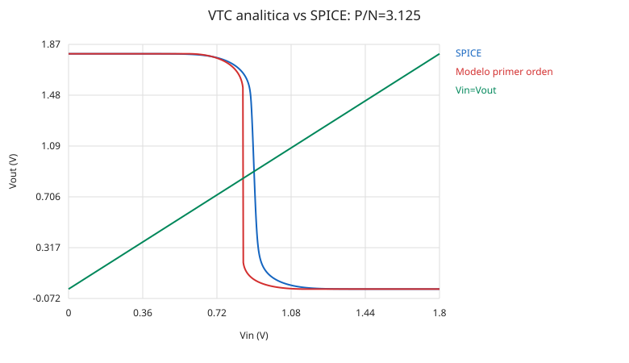
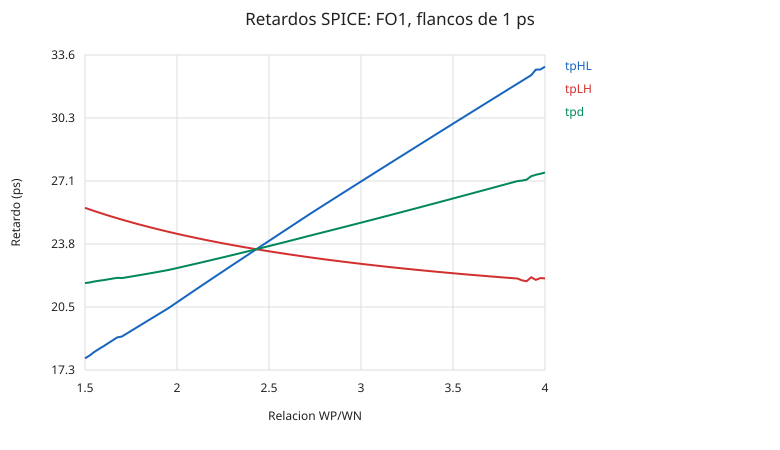
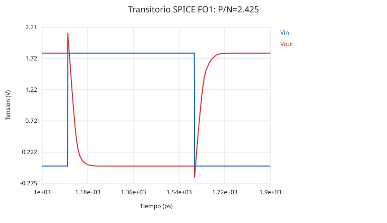

# Caracterización y dimensionamiento de un inversor CMOS

## Corrección metodológica vigente: completar antes de entregar

El informe [LaTeX](../tex.tex) conserva las mediciones SPICE existentes,
pero ya no presenta la integración adicional de corriente como método
principal de 1.b ni la extracción directa FO1 como cumplimiento definitivo
de Weste 8.4.5. Las secciones anteriores de este README que contienen
`CL=2(Cgn+Cgp)`, extracción directa FO1 o retardos independientes integrados
quedan como **antecedentes preliminares**, no como el método corregido.
Los resultados DC y de descarga no se invalidan por ese cambio.

El [README original](README.md) ya documenta el montaje en Custom Compiler
mediante el [esquemático del inversor](Imagenes/sch_inversor.png).
Esta captura se incorpora también al informe LaTeX: muestra los modelos
ne/pe, WN=0.36 um, WP=0.72 um, L=0.18 um y VDD=1.8 V.
Corresponde al circuito inicial sin carga FO1; los resultados cuantitativos
del informe provienen de los decks de caracterización descritos aquí.
El informe también incorpora las curvas de salida originales
[NMOS](Imagenes/NMOS_Ids_Vds.png) y [PMOS](Imagenes/PMOS_Ids_Vds.png),
y la [respuesta por esquinas de proceso](Imagenes/transient_inv_esquinas.png).
Se presentan como caracterización complementaria, conservando sus
condiciones y sin sustituir los resultados de las nuevas extracciones.

El nuevo flujo es:

1. Calcular compuerta y difusión con los coeficientes del modelo aportados.
2. Empezar en PMOS/NMOS=2 y medir retardos FO3 y FO4 con entrada conformada
   por inversores, común a las dos ramas.
3. Extraer resistencia por diferencias de retardo, siguiendo Weste 8.4.5.
4. Proponer el nuevo tamaño con la condición de simetría de Rabaey 5.4.3,
   recalcular capacitancias y repetir las simulaciones.
5. Comprobar FO1 por separado con entrada casi ideal, y verificar también
   la VTC del tamaño analítico DC 6.26462740748, fuera de la malla anterior.

### Cálculo manual implementado

[methodology_model.py](scripts_py/methodology_model.py) contiene los
coeficientes típicos transcritos de los extractos que proporcionó el
estudiante, sin copiar el PDK. Se conservan las dimensiones dibujadas:
`L=0.18 um`, `WN=0.36 um`, `AD=W*0.45 um`, `PD=2W+0.90 um`.
Con PERMOD=1, el borde de compuerta W se separa del perímetro STI `PD-W`.
No se introducen correcciones geométricas de BSIM aisladas.

- `Cox=epsilon0*3.9/toxe`.
- `Cin=W*L*Cox+2*W*Cov`: incluye los dos solapes, no solo Cgs.
- La unión usa las contribuciones de área, STI y borde de compuerta,
  cada una con su coeficiente, potencial y exponente.
- Su equivalente de carga promedia C(V) entre 0.9 y 1.8 V mediante la
  integral cerrada de `(1+V/PB)^(-M)`. No es una nueva extracción de R.
- Para salida se añade `2*W*Cov` como aproximación Miller de primer orden;
  no se añade otro Cgd encima de ese término.
- Los coeficientes de temperatura de las uniones consultadas eran cero;
  esto no significa que todo el modelo MOS sea independiente de temperatura.

En r=2 se calculan, no se miden:
`Cin_N=0.710211 fF`, `Cin_P=1.388559 fF`,
`Cj_N=0.609600 fF`, `Cj_P=0.925305 fF`,
`Cint=1.940409 fF`, `CL_FO1=4.039179 fF`.
La carga corregida es `CL(r)=1.662869+1.188155*r` fF;
no debe mezclarse con los coeficientes preliminares 1.334016/1.385136.
Los supuestos de dimensión dibujada, promedio de carga y Miller constante
siguen siendo de primer orden y se declaran en el reporte.

La extracción usa `R_RC=delta_t/(ln(2)*delta_C)`, con
`delta_C=Cin_N+Cin_P`. Se exporta también la convención del libro,
`R_Weste=ln(2)*R_RC`. El PMOS se refiere al ancho NMOS multiplicando
su resistencia por r. Los tiempos de entrada/salida 20-80% se exportan para
verificar pendientes comparables; no se presume que sean adecuadas antes
de correr. El cálculo de difusión sigue siendo necesario para predecir FO1,
aunque la resta de retardos cancele la contribución intrínseca común
en el modelo lineal.

### Ejecución nueva en el servidor Linux

Desde la raíz de este proyecto, con HSPICE disponible en PATH:

```bash
python3 scripts_py/complete_methodology.py prepare --ratio 2
bash spice_decks/run_methodology.sh
```

El runner imprime una carpeta nueva `spice_decks/resultados_metodologia_...`.
Conservarla completa: incluye los decks, las geometrías y el tamaño usado.
Analizar esa carpeta, sustituyendo el nombre real:

```bash
python3 scripts_py/complete_methodology.py analyze spice_decks/resultados_metodologia_NOMBRE_REAL
```

El análisis rechaza errores, advertencias, medidas fallidas, diferencias
de retardo no positivas y tamaños incompatibles. Escribe `extraccion.csv`
y `capacitancias.csv` en `analisis_metodologia` y propone el siguiente r.
Para la siguiente iteración:

```bash
python3 scripts_py/complete_methodology.py prepare --ratio VALOR_PROPUESTO
bash spice_decks/run_methodology.sh
```

No se declara convergencia automáticamente ni se reemplazan resultados
por predicciones. Se debe revisar la estabilidad de r y la simetría FO1
antes de incorporar valores definitivos al informe. La comparación de
retardos FO1 con resistencias extraídas es una comprobación de transferencia
entre condiciones distintas, no una identidad garantizada.

### Primera iteración recibida y analizada

Se procesó [resultados_metodologia_20261117_010133_A0PVhQ](spice_decks/resultados_metodologia_20261117_010133_A0PVhQ).
Las tres simulaciones concluyeron normalmente, sin advertencias, errores
ni medidas fallidas. Los resultados derivados están en
[analisis_metodologia](spice_decks/resultados_metodologia_20261117_010133_A0PVhQ/analisis_metodologia).

| Magnitud | Resultado |
|---|---:|
| r medido | 2 |
| Diferencia FO4-FO3, HL / LH | 7.96798 / 9.82549 ps |
| Rn RC, W=0.36 um | 5.47719 kohm |
| Rp RC, W=0.72 um | 6.75404 kohm |
| Rp RC referido a W=0.36 um | 13.50808 kohm |
| Rn / Rp referido, convención Weste | 3.79650 / 9.36309 kohm |
| r propuesto / WP propuesto | 2.46624222803 / 0.887847 um |
| VM SPICE en r analítico=6.26462740748 | 0.951065 V |
| Isc pico en r analítico | 34.6291 uA |

El tamaño estático analítico excede el objetivo de VM en 51.065 mV.
Frente a la descarga con 2 pF, las resistencias RC a igual ancho difieren
-15.08% (N) y +9.61% (P). Se comparan caracterizaciones efectivas distintas,
no una resistencia exacta universal.

En r=2, el modelo FO3/FO4 predice FO1 HL/LH de 15.3347/18.9096 ps;
la simulación FO1 mide 20.7808/24.3265 ps. Los errores son -26.21%/-22.27%.
La entrada conformada y la comprobación con flancos de 1 ps son condiciones
diferentes; las capacitancias manuales siguen siendo aproximadas.
Los cocientes salida/entrada de tiempos 20-80% son 0.746/1.265 (FO3) y
0.894/1.543 (FO4), para salida de bajada/subida: del mismo orden, no iguales.

La predicción simétrica en r=2.46624222803 es 17.4379 ps, con carga
4.59315 fF. **No es una medida ni se declara convergencia.**
El include archivado en la carpeta de resultados conserva r=2 y no se
modifica. La segunda ejecución se preparó mediante:

```bash
python3 scripts_py/complete_methodology.py prepare --ratio 2.46624222803
bash spice_decks/run_methodology.sh
```

### Segunda iteración recibida y analizada

Se procesó [resultados_metodologia_20261117_010409_up5kCc](spice_decks/resultados_metodologia_20261117_010409_up5kCc).
Las tres simulaciones concluyeron normalmente, sin errores, advertencias
ni medidas fallidas. Las tablas están en
[analisis_metodologia](spice_decks/resultados_metodologia_20261117_010409_up5kCc/analisis_metodologia).

| Magnitud | Primera ejecución | Segunda ejecución |
|---|---:|---:|
| r simulado | 2 | 2.46624222803 |
| Rn RC, W=0.36 um (kohm) | 5.47719 | 5.20719 |
| Rp RC referido a W=0.36 um (kohm) | 13.50808 | 14.89710 |
| r propuesto | 2.46624222803 | 2.86086988240 |
| FO1 HL / LH (ps) | 20.7808 / 24.3265 | 23.7468 / 23.4727 |
| FO1 promedio (ps) | 22.5537 | 23.6098 |
| Asimetría FO1 (%) | 15.7211 | 1.16108 |

En la segunda ejecución, `delta_C=2.422473 fF` y las diferencias FO4-FO3
son 8.74355/10.14262 ps. El modelo recalibrado predice FO1
16.5783/19.2310 ps: errores -30.19%/-18.07%. Las razones de transición
salida/entrada son 0.851/1.110 para FO3 y 1.039/1.356 para FO4
(bajada/subida de salida). VM=0.883971 V e Isc pico=24.1533 uA.

**No hay convergencia demostrada:** el nuevo r propuesto aumenta 16.00%.
Las resistencias cambian -4.93%/+10.28% (N/P referido) entre extracciones,
porque cambian también las condiciones de entrada y polarización.
La comprobación FO1 sí mejora respecto a r=2, pero no supera el equilibrio
del barrido anterior r=2.425 (0.212%). No se debe confundir simetría FO1
con un punto fijo de la extracción FO3/FO4, ni asumir que la próxima
propuesta mejorará FO1.

Los includes archivados y sus mediciones permanecen intactos.
La tercera ejecución se preparó mediante:

```bash
python3 scripts_py/complete_methodology.py prepare --ratio 2.86086988240
bash spice_decks/run_methodology.sh
```

### Tercera ejecución: serie detenida sin convergencia demostrada

Se procesó [resultados_metodologia_20261117_010626_tFRR4h](spice_decks/resultados_metodologia_20261117_010626_tFRR4h).
Las tres simulaciones concluyeron normalmente, sin errores, advertencias
ni medidas fallidas. Sus tablas están en
[analisis_metodologia](spice_decks/resultados_metodologia_20261117_010626_tFRR4h/analisis_metodologia).

| Magnitud | Resultado |
|---|---:|
| r simulado | 2.8608698824 |
| Rn RC, W=0.36 um | 4.89195 kohm |
| Rp RC referido a W=0.36 um | 15.98680 kohm |
| Diferencia FO4-FO3 HL / LH | 9.14324 / 10.44437 ps |
| delta_C | 2.696454 fF |
| FO1 HL / LH | 26.1924 / 22.9329 ps |
| FO1 promedio | 24.5626 ps |
| Asimetría FO1 | 13.2701% |
| VM / Isc pico | 0.894083 V / 25.6466 uA |
| Nueva propuesta, NO simulada | 3.26798453915 |

La asimetría FO1 evoluciona **15.721% -> 1.161% -> 13.270%**.
La última propuesta aumenta r otro 14.23%: no se demuestra estabilidad.
Las razones de transición salida/entrada son 0.954/1.004 (FO3) y
1.172/1.219 (FO4), para bajada/subida de salida; tener pendientes
comparables no garantiza la convergencia de esta regla.
El modelo recalibrado predice FO1 17.1645/19.6071 ps, errores
-34.47%/-14.50%. Frente a descarga, las resistencias RC a igual ancho
difieren -24.15%/+29.73%.

**Se detiene esta serie sin preparar automáticamente otra ejecución.**
Tres puntos no prueban divergencia para cualquier número de iteraciones,
pero sí muestran que no se ha logrado convergencia ni mejora monótona
de la simetría FO1. Antes de continuar habría que revisar la transferencia
entre las condiciones FO3/FO4 y FO1 y el escalamiento supuesto con ancho.
El include de trabajo conserva r=2.8608698824, no la propuesta sin probar.
El mejor equilibrio medido sigue siendo r=2.425, asimetría 0.212%,
del barrido previo. No se afirma que 2.b tenga un tamaño convergido.

## Alcance y condiciones

Proyecto de caracterización de una tecnología de 0.18 micrometros, con alimentación de 1.8 V. Se estudian por separado el centrado de la VTC y la simetría de retardos. Se extrae resistencia efectiva por descarga de capacitor y por retardos de un inversor con carga idéntica (FO1).

Condiciones de las mediciones: HSPICE U-2023.03-SP2, esquina `tm`, temperatura 70 grados Celsius, modelos `ne` y `pe` de las librerías XT018 del servidor. Se dispone de parámetros analíticos XH018 [3]; su correspondencia exacta con esos modelos aún debe verificarse.

El NMOS de referencia usa W=4 lambda=0.36 micrometros y L=2 lambda=0.18 micrometros, con lambda=90 nm. Las difusiones se modelan con áreas W por 5 lambda y perímetros 2W+10 lambda, siguiendo la celda original con contactos. Estas dimensiones se usan como regla escalable de partida, no como una validación DRC nueva.

Las mediciones previas están en este documento, con la salvedad metodológica
indicada al inicio. El [README original](README.md) no se modifica; las
estimaciones iniciales y derivaciones ampliadas se conservan en
[antecedentes y memoria extendida](README_antecedentes.md), sin considerarse
simultáneamente resultados finales.

## 1.a. Dimensionamiento analítico y caracterización DC

### Parámetros y modelo por regiones

Se toman de [3] los siguientes parámetros. VT corresponde a W/L=10/0.18 micrometros y VD=0.1 V; K'L a transistores largos. No son valores extraídos a los anchos y temperatura de las pruebas.

| Parámetro | NMOS | PMOS |
|---|---:|---:|
| K'L (microamperios/V2) | 256 | 52 |
| Magnitud VT (V) | 0.58 | 0.65 |
| ION/W a VG=VD=1.8 V (microamperios/micrometro) | 475 | 170 |
| Cox (fF/micrometro2) | 8.46 | 8.91 |
| Cov (fF/micrometro) | 0.33 | 0.32 |

En el objetivo VM=0.9 V, los sobrevoltajes son 0.32 V y 0.25 V. Ambos transistores cumplen VD mayor que el sobrevoltaje en el criterio de saturación de canal largo; eso no demuestra saturación de velocidad. [3] advierte que puede haber saturación de velocidad, especialmente en NMOS mínimo.

Se implementan las ecuaciones (2.24)-(2.29) de Weste y Harris [1], sección 2.4.1, pp. 76-77, en [first_order_model.py](scripts_py/first_order_model.py). Para magnitudes de tensión, \(u=\max(V_G-|V_T|,0)\), \(V_c=E_cL=2v_{sat}L/\mu_{eff}>0\), \(g=K'_L/L\):

$$V_{D,sat}=\frac{uV_c}{u+V_c},\quad d=\min(V_D,V_{D,sat})$$
$$j(V_G,V_D)=\frac{I}{W}=g\frac{ud-d^2/2}{1+d/V_c}$$
$$j_{sat}=\frac{gV_c}{2}\frac{u^2}{u+V_c}$$

En corte la corriente es cero. En región lineal d=VD y en saturación se limita d según la ecuación (2.27) del libro. Para u mucho menor que Vc se recupera el límite cuadrático; para u mucho mayor, el límite lineal. Se omiten subumbral, DIBL, modulación de longitud, efecto de cuerpo y variaciones de movilidad con campo vertical. Aproximar la movilidad efectiva mediante K'L del material de curso es un supuesto adicional, no una extracción a la geometría mínima.

Como no se dispone de Ec medido, Vc se infiere del ION tabulado, sin ajustar a la VTC SPICE. Con \(u_{ON}=V_{DD}-|V_T|\):

$$V_c=\frac{2j_{ON}u_{ON}}{gu_{ON}^2-2j_{ON}}$$

Resulta \(V_{c,n}=0.99328\) V y \(V_{c,p}=9.29723\) V. Son parámetros equivalentes, no mediciones del campo crítico. En el objetivo VM=0.9 V, u/Vc vale 0.322 para NMOS y 0.0269 para PMOS: el PMOS queda próximo al régimen cuadrático y el NMOS requiere corrección; ninguno justifica el límite de saturación completa de velocidad. Esta formulación reemplaza el modelo gradual anterior, que no reproducía la ecuación (2.27) del texto.

La VTC se obtiene imponiendo:

$$W_Nj_n(V_{in},V_{out})=
W_Pj_p(V_{DD}-V_{in},V_{DD}-V_{out})$$

Para VM=0.9 V se predice P/N=6.26463, WP=2.25527 micrometros, del cociente de corrientes por ancho 55.0747/8.79138. La predicción no coincide con SPICE y no se usa como tamaño final. La estimación inicial lineal daba 3.37, pero era otra hipótesis y no una VTC por regiones validada. Se documenta el desacuerdo en lugar de escoger únicamente la aproximación más cercana.

### Contraste con SPICE y corriente DC aislada

Fuente: [resultados de la nueva ejecución](spice_decks/resultados_caracterizacion_20261116_231335_H9qsFY). Se midieron 101 ratios entre 1.5 y 4 con paso 0.025, y 901 puntos de entrada de 0 a 1.8 V cada 2 mV. No hubo errores, advertencias ni medidas fallidas en esta ronda.

El mejor centrado muestreado ocurre en P/N=3.125, WP=1.125 micrometros, VM=0.900232 V. El error respecto a VDD/2 es 0.232 mV. VM se mide en el cruce Vin=Vout, no solo donde Vout=0.9 V.

| P/N | VM analítico (V) | VM SPICE (V) | Error analítico menos SPICE (mV) | RMSE Vout en toda la VTC (V) |
|---|---:|---:|---:|---:|
| 3.125 | 0.847339 | 0.900232 | -52.893 | 0.24380 |
| 2.425 | 0.828223 | 0.882846 | -54.623 | 0.24545 |
| 3.375 | 0.853179 | 0.905662 | -52.482 | 0.24251 |



El modelo analítico sin modulación de longitud tiene una transición abrupta; no se añade una pendiente empírica para disimularlo. El RMSE incluye el desplazamiento de esa transición. La discrepancia puede originarse en parámetros de canal largo, umbrales de otra anchura/polarización, temperatura no corregida y transporte no representado por el modelo. Conocer ION a alimentación completa no determina las corrientes cerca del umbral. Las capacitancias no explican el desplazamiento de una VTC estática.

La alimentación del inversor bajo prueba está separada de la carga. Se mide el pico DC como \(\max[-I(VDRV)]\), incluyendo la pequeña fuga propia, no la corriente de la carga. Para P/N=3.125 resulta **26.5702 microamperios**. No es el pico de alimentación transitorio con contribución capacitiva. Se descarta la antigua medida llamada Isc que no solicitaba ninguna corriente.


## 1.b. Retardo con carga de un inversor idéntico

### Correspondencia con Rabaey, sección 5.4.3

Se verificó la sección en el [libro local](../Proyectos_proyecto1_Rabaey-Digital-Integrated-Circuits-A-Design-Perspective.pdf).
Comienza en la página impresa 199 (194 del PDF), antes del intervalo
201-207 mencionado en el proyecto. Las ecuaciones (5.23)-(5.28) distinguen
la relación de anchos, la relación de resistencias y las cargas:

$$C_{int}=C_{db,n}+C_{db,p},\qquad C_{ext}=C_{gn}+C_{gp},\qquad C_L=C_{int}+C_{ext}$$

No se agrega cableado al deck. La carga FO1 escala con el inversor,
no es un capacitor externo fijo. Conservamos `r=WP/WN` y llamamos
`rho=Rp0/Rn0` a la relación de resistencias a igual ancho; Rabaey usa
beta para tamaños y r para resistencias.

Con `CL=A+B*r`, la ecuación (5.25) se generaliza a
`tpd=ln(2)/2*(A+B*r)*Rn0*(1+rho/r)`.
Su derivada es `ln(2)/2*(B*Rn0-A*Rp0/r^2)`, y el mínimo libre ocurre
en `r_min=sqrt(A*rho/B)`. Para A=B se recupera `sqrt(rho)` de (5.26),
pero ese punto no exige simetría. El proyecto sí la exige:
`tHL=tLH` fija `r_sym=rho`, con WN mínimo.

Con las resistencias de 2.b, la primera propuesta es r=2.34125,
WP=0.84285 micrometros. Recalculando capacitancias y resistencias,
la propuesta final es r=2.43014, WP=0.87485 micrometros, que selecciona
r=2.425 en la malla. Congelando los valores de la última iteración se
predicen 23.5233 ps por flanco en r=2.43014; es una estimación calibrada,
no un nuevo punto simulado. El mínimo libre local r=1.52986 no se adopta
porque no cumple la simetría solicitada.

Las ecuaciones (5.27)-(5.28) explican el efecto de escalar ambos anchos.
Con una carga FO1 que escala igualmente, R disminuye como 1/S y
la carga aumenta como S; el modelo ideal no predice mejora del producto RC.
Por ello se conserva el NMOS mínimo y se ajusta la relación de tamaños.
La integración de corriente siguiente es una comprobación independiente
adicional, no reemplaza la extracción e iteración requeridas por el proyecto.

### Predicción independiente

La carga FO1 es otro inversor del mismo tamaño. Para capacitancias se adopta el modelo pesimista de primer orden de [3]:

$$C_g=WL C_{ox}+W C_{ov},\qquad C_{db}\approx C_{gs}$$
$$C_{gn}=0.667008\ {\rm fF},\qquad C_{gp}(r)=0.692568r\ {\rm fF}$$
$$C_L=C_{gn}+C_{gp}+C_{db,n}+C_{db,p}=A+Br$$

Con r=WP/WN, A=1.334016 fF y B=1.385136 fF. No se suman esos capacitores a SPICE, que ya contiene capacitancias internas. Esta aproximación de difusión no equivale a extraer parámetros de unión BSIM.

Para una entrada ideal que activa completamente el transistor, se integra el modelo de corriente entre VD=1.8 y 0.9 V:

$$t_{1/2}=C_L\int_{V_{DD}/2}^{V_{DD}}\frac{dV}{I(V)},\qquad
R_{eff,modelo}=\frac{1}{\ln 2}\int_{V_{DD}/2}^{V_{DD}}\frac{dV}{I(V)}$$

Simpson con 1000 subintervalos da, a W=0.36 micrometros, Rn0=7.59313 kOhm y Rp0=21.24548 kOhm. No se usan retardos SPICE en esta predicción:

$$t_{HL}(r)=\ln2\,R_{n0}(A+Br),\quad
t_{LH}(r)=\ln2\,\frac{R_{p0}}r(A+Br)$$
$$t_{pd}(r)=\frac{\ln2}{2}(A+Br)(R_{n0}+R_{p0}/r)$$

Sin restricción, derivar tpd da \(r_{min}=\sqrt{AR_{p0}/(BR_{n0})}\). Bajo la restricción de igualdad de retardos se exige \(r_{sym}=R_{p0}/R_{n0}=2.79799\). Con WN fijo hay un único r factible en este modelo; no es el mínimo libre de tpd.

El mínimo libre independiente es r=1.64156; se descarta por no satisfacer
simetría. La solución simétrica independiente requiere WP=1.00728 micrometros.

| P/N | tpHL modelo (ps) | tpLH modelo (ps) | tpHL SPICE (ps) | tpLH SPICE (ps) |
|---|---:|---:|---:|---:|
| 2.425 | 24.6998 | 28.4989 | 23.4876 | 23.5374 |
| 3.125 | 29.8030 | 26.6843 | 27.7825 | 22.6371 |
| 2.79799 | 27.4190 | 27.4190 | No simulado exactamente | No simulado exactamente |

SPICE a r=2.8 da 25.8240 y 23.0078 ps, sin simetría. Las diferencias respecto al modelo pueden incluir transporte no lineal, capacitancias dependientes de tensión y de la transición, efectos de anchura y flancos de entrada finitos. La corriente de equilibrio DC no se usa para representar un flanco; se retira la antigua predicción de 83 ps basada en esa sustitución.

### Ajuste SPICE y comparación de ambos diseños

Se usan flancos de entrada de 1 ps y el segundo ciclo. La asimetría se define como \(100|t_{LH}-t_{HL}|/t_{pd}\).

| Diseño | P/N | WP (micrometros) | VM (V) | Pico DC (microamperios) | tpHL (ps) | tpLH (ps) | tpd (ps) | Asimetría (%) |
|---|---:|---:|---:|---:|---:|---:|---:|---:|
| Inicial | 2.000 | 0.720 | 0.870233 | 22.1810 | 20.7808 | 24.3265 | 22.5537 | 15.721 |
| Mejor simetría temporal muestreada | 2.425 | 0.873 | 0.882846 | 23.9902 | 23.4876 | 23.5374 | 23.5125 | 0.212 |
| Mejor centrado DC muestreado | 3.125 | 1.125 | 0.900232 | 26.5702 | 27.7825 | 22.6371 | 25.2098 | 20.410 |

El ajuste dinámico reduce el ratio aproximadamente 13.3% respecto al r analítico 2.79799. La diferencia de retardos es 0.04982 ps en la malla, no una prueba de igualdad exacta ni de óptimo continuo. P/N=2 tiene menor retardo promedio pero no satisface simetría.

Respecto al diseño centrado DC, el temporal reduce tpd aproximadamente 6.7% y pico DC aproximadamente 9.7%, a costa de desplazar VM. Sus tiempos 20-80% son tfall=24.1922 ps y trise=29.2776 ps: igualdad de retardo de propagación no implica igualdad de tiempo de transición.






Las ondas se extrajeron del `.tr0`, no se reconstruyeron como exponenciales. Se verificaron los cruces de 0.9 V para los 101 ratios contra las medidas: diferencia máxima inferior a 0.000002 ps. Se muestran las sobreoscilaciones sin recortarlas; no se atribuyen a inductancias físicas ausentes del deck. Los extremos de la ventana gráfica se interpolan linealmente entre muestras almacenadas para conservar el nivel previo al flanco.

## 2.a. Resistencia efectiva por descarga de capacitor

Se prueban NMOS y PMOS con W/L=0.36/0.18 micrometros. El NMOS descarga un capacitor inicialmente a 1.8 V; el PMOS carga un capacitor desde cero, de modo que VSD cae de 1.8 a 0.9 V. Ambas puertas quedan completamente activadas.

$$R_n(t)=V(dn)/I(VSN),\qquad
R_p(t)=[V_{DD}-V(dp)]/[-I(VSP)]$$

Se promedia aritméticamente V/I en el intervalo de tensión de canal [0.9,1.8] V, con muestras uniformes cada 10 ps. Se excluye t=0 porque UIC imprime corriente cero. Es una media uniforme en tiempo, no en voltaje; no se extrapolan los extremos.

| C | Muestras NMOS | Rn promedio (kOhm) | Muestras PMOS | Rp promedio (kOhm) | Rn por tiempo medio (kOhm) | Rp por tiempo medio (kOhm) |
|---|---:|---:|---:|---:|---:|---:|
| 1 pF | 439 | 6.45319 | 833 | 12.33541 | 6.34709 | 12.02375 |
| 2 pF | 870 | 6.44970 | 1663 | 12.32330 | 6.27740 | 11.99938 |

Al duplicar C, el promedio cambia 0.054% en NMOS y 0.098% en PMOS, respaldando estabilidad frente al capacitor y predominio de carga externa. No separa todos los errores de integración/inicialización. Se adopta 2 pF: Rn=6.44970 kOhm, Rp=12.32330 kOhm; relación a igual ancho 1.91068.

Las resistencias por tiempo medio se calculan como \(t_{1/2}/[\ln(2)C]\). Tienen otra ponderación y no sustituyen el promedio solicitado de V/I. Las corrientes de fuente también contienen contribuciones internas cuya importancia relativa disminuye con C externa grande.


## 2.b. Extracción desde retardo y parásitas

Se revisó [1], sección 8.4.5, pp. 310-311. El libro calibra una resistencia
efectiva mediante una expresión de la forma `t = R_efectiva C`, mientras
aquí se conserva la convención explícita `t = ln(2) R_RC C`.
La conversión es `R_efectiva = ln(2) R_RC`; no deben compararse valores
numéricos sin distinguir ambas definiciones. También se propone en el libro
restar retardos a distintos fanouts para cancelar difusión. Aquí se usa la
carga total calculada, como adaptación a la instrucción del proyecto de
calcular las capacitancias manualmente; no se realizó esa resta.
El ratio extraído se utiliza para el ajuste de 1.b; la integral de corriente
es una comprobación independiente adicional. Los flancos de 1 ps aproximan
la entrada ideal solicitada en 1.b, pero no la pendiente realista recomendada
por el libro para caracterizar resistencia reutilizable en cadenas.

Usando CL calculada manualmente:

$$R_{n,ret}=t_{HL}/[\ln(2)C_L],\qquad
R_{p,ret}(W_P)=t_{LH}/[\ln(2)C_L]$$

Se refiere el PMOS a W=0.36 micrometros mediante \(R_{p,ret}(0.36)\approx rR_{p,ret}(W_P)\). Se empieza con r=2, se recalcula CL y se propone \(r_{nuevo}=R_{p,ret}(0.36)/R_{n,ret}\), eligiendo el punto de malla más próximo.

| Paso | r | CL (fF) | Rn (kOhm) | Rp referido a 0.36 micrometros (kOhm) | r propuesto | Siguiente r |
|---|---:|---:|---:|---:|---:|---:|
| 0 | 2.000 | 4.104288 | 7.30465 | 17.10199 | 2.34125 | 2.350 |
| 1 | 2.350 | 4.589086 | 7.23544 | 17.47951 | 2.41582 | 2.425 |
| 2 | 2.425 | 4.692971 | 7.22047 | 17.54679 | 2.43014 | 2.425 |

La iteración converge en la malla y coincide con el menor desequilibrio medido. No es una predicción independiente: usa retardos SPICE y carga aproximada. El cociente de resistencias cancela la carga común; la convergencia del ratio no valida la exactitud absoluta de CL. El escalamiento inverso con ancho también es aproximado.

## 2.c. Comparación de métodos

A igual tamaño r=2.425 y CL=4.692971 fF:

| Método | Rn (kOhm) | Rp referido a 0.36 micrometros (kOhm) | tpHL (ps) | tpLH (ps) |
|---|---:|---:|---:|---:|
| Descarga 2 pF y predicción RC | 6.44970 | 12.32330 | 20.98 | 16.53 |
| Extracción desde FO1 con CL aproximada | 7.22047 | 17.54679 | 23.49 medido | 23.54 medido |

Las resistencias por retardo exceden las de descarga aproximadamente 12.0% en NMOS y 42.4% en PMOS. Las diferencias incluyen posibles errores de CL, acoplamiento puerta-drenador, trayectoria de polarización, forma de entrada y escalamiento con ancho. No se atribuye toda la discrepancia a un único mecanismo.

Para diseño manual de compuertas similares se prefiere la calibración por retardo porque refleja ese entorno; sus valores absolutos dependen de CL. La descarga es más directa para verificar V/I con carga dominante y supone menos sobre la capacitancia interna. Las pruebas duran 50 ns simulados frente a 3 ns para FO1, pero no se midió tiempo de CPU comparable: no se confunde duración simulada con costo computacional.

## Reproducibilidad y trazabilidad

Desde la raíz del proyecto, en el servidor Linux:

```bash
bash spice_decks/run_characterization.sh
```

Análisis local de la ejecución incluida, con Python estándar y sin paquetes externos:

```bash
python scripts_py/analyze_characterization.py spice_decks/resultados_caracterizacion_20261116_231335_H9qsFY
python -m unittest discover -s scripts_py -p test_analyze_characterization.py -v
```

Los decks [DC](spice_decks/characterization_dc.sp), [transitorio](spice_decks/characterization_tran.sp) y [descarga](spice_decks/channel_discharge.sp) comparten [geometrías y librerías](spice_decks/characterization_common.inc), con alimentación de carga aislada del inversor bajo prueba y nodo de referencia 0. Las librerías institucionales están en `/mnt/vol_NFS_rh003/estudiantes/dmedina_cadence/vlsi/Hspice/lp5mos/`.

El [script de análisis](scripts_py/analyze_characterization.py) genera las figuras y las tablas de [comparación](spice_decks/resultados_caracterizacion_20261116_231335_H9qsFY/analisis/comparacion.csv), [descarga](spice_decks/resultados_caracterizacion_20261116_231335_H9qsFY/analisis/resistencias.csv), [iteración](spice_decks/resultados_caracterizacion_20261116_231335_H9qsFY/analisis/iteracion.csv), [error del modelo VTC](spice_decks/resultados_caracterizacion_20261116_231335_H9qsFY/analisis/modelo_vtc.csv) y [verificación de ondas](spice_decks/resultados_caracterizacion_20261116_231335_H9qsFY/analisis/verificacion_ondas.csv).

El lector binario solo admite el formato 2013 little-endian y las columnas comprobadas de esta ejecución. Rechaza otros formatos, datos truncados y discrepancias de retardos mayores a 1 ps; la discrepancia real obtenida es muy inferior.

### Figuras de publicación para el informe LaTeX

Todas las figuras del informe, incluido el esquema CMOS, se generan con
[Python y Matplotlib](scripts_py/plot_report_figures.py). Desde la raíz de este proyecto:

```powershell
python -m pip install -r scripts_py\requirements-figures.txt
python scripts_py\plot_report_figures.py spice_decks\resultados_caracterizacion_20261116_231335_H9qsFY
python -m unittest discover -s scripts_py -p "test_*.py" -v
```

La salida predeterminada es [figuras_latex](../figuras_latex), junto a
[tex.tex](../tex.tex): 10 figuras en PDF/SVG vectoriales y PNG a **600 dpi**.
El informe utiliza los PDF para conservar trazos y texto nítidos al ampliar.
Para compilar basta subir el fuente LaTeX y esa carpeta, manteniendo su ubicación relativa.
No se requiere PGFPlots ni conversión de SVG. `--output` permite elegir otra
carpeta y `--dpi` cambiar la resolución PNG (mínimo 300).

Los ejes conservan datos SI internamente y muestran una unidad de ingeniería
consistente por eje: V, ns, ps, µA y kΩ; las razones de anchos usan `(1)`.
Se incluyen leyendas, estilos de línea distinguibles y detalles de los cruces
al 50% para leer los retardos. Las curvas casi coincidentes de resistencia
se separan por transistor y por estilo, sin alterar los resultados.
Los archivos `.dat` exportados conservan las unidades del exportador original
(ps, µA y kΩ donde corresponda); el graficador convierte explícitamente a SI.
El análisis estándar anterior sigue funcionando sin Matplotlib.

## Justificación del alcance de primer orden

El objetivo es dimensionar con modelos manuales, comprobar mediante SPICE y explicar las diferencias, no reproducir internamente BSIM4. Se conserva el modelo aproximado de capacitancias de [3] y se declara dónde se utiliza. No se requiere reconstruir todas las correcciones geométricas y térmicas para realizar este contraste de primer orden.

Como comprobación de los parámetros base, se consultaron en el servidor los modelos `ne`, `pe` y su esquina típica. Las capturas confirman BSIM4 4.7, espesores TOXE de 4.1 nm y 3.9 nm, y EPSROX=3.9. No se distribuyen los archivos del PDK.

| Comprobación | NMOS | PMOS |
|---|---:|---:|
| Cox geométrico del modelo, aproximado (fF/micrometro2) | 8.42 | 8.85 |
| Cox usado del material [3] (fF/micrometro2) | 8.46 | 8.91 |
| Solape nominal CGSO=CGDO del modelo (fF/micrometro) | 0.2284 | 0.1674 |
| Cov usado del material [3] (fF/micrometro) | 0.33 | 0.32 |

Cox difiere menos de 1%, lo que respalda esa aproximación geométrica. Los coeficientes de solape no coinciden igual de bien y no representan por sí solos toda la capacitancia de entrada de BSIM. Por ello, no se afirma equivalencia entre todas las capacitancias ni se reemplazan coeficientes aislados sin recalcular el modelo completo de carga usado.

El contraste dinámico independiente a r=2.425 predice 24.70/28.50 ps frente a 23.49/23.54 ps en SPICE: diferencias aproximadas de 5.2% y 21.1%, respectivamente. Es una aproximación útil pero de precisión desigual. El desplazamiento de unos 52.9 mV de la VTC analítica del diseño DC es una discrepancia relevante que debe reportarse, no describirse como coincidencia exacta.

En síntesis, los modelos manuales orientan el dimensionamiento y muestran el orden de magnitud; SPICE permite ajustar la solución con un modelo más completo. Las discrepancias se cuantifican y se relacionan con los supuestos, sin exigir que el modelo manual reconstruya BSIM.

## Alcance y límites de la entrega

- Confirmar la correspondencia XH018/XT018 y los parámetros a los anchos/temperatura de prueba. La comparación analítica está realizada, pero muestra que no es válido afirmar dimensionamiento exacto con estos parámetros.
- Las capacitancias de difusión se aproximan según [3]. Si se exige literalmente calcularlas desde parámetros del simulador, esa parte de 2.b sigue pendiente; no se declara cumplida únicamente por haber consultado el modelo.
- Refinar la malla alrededor de r=2.425 solo si se desea afirmar mayor precisión; el resultado actual declara paso 0.025.
- Se verificó el modelo de corriente contra [1], sección 2.4.1, ecuaciones (2.24)-(2.29), y el dimensionamiento temporal contra [2], sección 5.4.3, ecuaciones (5.23)-(5.28). Se distingue el mínimo libre del dimensionamiento restringido por simetría. Esto no resuelve por sí solo la aproximación de difusión pendiente de 2.b.

## Referencias

[1] N. Weste y D. Harris, *CMOS VLSI Design: A Circuits and Systems Perspective*, 4a edición. Addison-Wesley, 2010.

[2] J. Rabaey, A. Chandrakasan y B. Nikolic, *Digital Integrated Circuits: A Design Perspective*, 2a edición. Prentice Hall, 2005.

[3] A. Chacón Rodríguez, *Parámetros de primer orden para tecnología XFAB 0.18 micrometros (Bulk CMOS XH018)*, material de curso, Instituto Tecnológico de Costa Rica, 2018. [Documento local](../Proyectos_proyecto1_XFAB_XH018_param_1er_orden.pdf).
